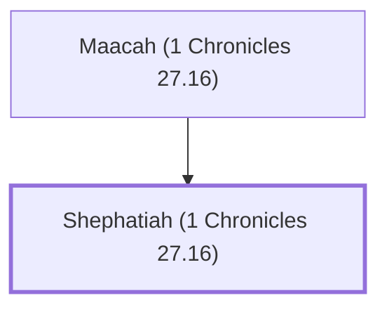

# Shephatiah (1 Chronicles 27.16)

Ruler of the Simeonites under David

**Original-language names:** שְׁפַטְיָהוּ (H8203)

## When

- **Placed around:** [[connections/timeline/11th century BC|1015 BC]] *(Ussher: the median date of the passages naming them)*

## Family

- **Father:** [[connections/people/Maacah (1 Chronicles 27.16)|Maacah (1 Chronicles 27.16)]]

**Family group:** [[connections/genealogy/Family of Maacah (1 Chronicles 27.16)|Family of Maacah (1 Chronicles 27.16)]], generation 2

## Appears in

[[connections/chapters/13-1-chronicles/1 Chronicles 27|1 Chronicles 27]]

## Appears in the same verse as

[[connections/people/Eliezer (1 Chronicles 27.16)|Eliezer (1 Chronicles 27.16)]] · [[connections/people/Israel|Israel]] · [[connections/people/Maacah (1 Chronicles 27.16)|Maacah (1 Chronicles 27.16)]] · [[connections/people/Simeon (Genesis 29.33)|Simeon (Genesis 29.33)]] · [[connections/people/Zichri (1 Chronicles 27.16)|Zichri (1 Chronicles 27.16)]]
