# Shephatiah (2 Samuel 3.4)

Son of David and Abital

**Original-language names:** שְׁפַטְיָהוּ (H8203)

## When

- **Placed around:** [[connections/timeline/11th century BC|1048 BC]] *(Ussher: the median date of the passages naming them)*

## Family

- **Father:** [[connections/people/David|David]]
- **Mother:** [[connections/people/Abital|Abital]]
- **Brothers and sisters:** [[connections/people/Absalom|Absalom]], [[connections/people/Adonijah (2 Samuel 3.4)|Adonijah (2 Samuel 3.4)]], [[connections/people/Amnon (2 Samuel 3.2)|Amnon (2 Samuel 3.2)]], [[connections/people/Chileab|Chileab]], [[connections/people/Eliada (2 Samuel 5.16)|Eliada (2 Samuel 5.16)]], [[connections/people/Eliphelet (2 Samuel 5.16)|Eliphelet (2 Samuel 5.16)]], [[connections/people/Elishama (2 Samuel 5.16)|Elishama (2 Samuel 5.16)]], [[connections/people/Elishua|Elishua]], [[connections/people/Elpelet|Elpelet]], [[connections/people/Ibhar|Ibhar]], [[connections/people/Ithream|Ithream]], [[connections/people/Japhia (2 Samuel 5.15)|Japhia (2 Samuel 5.15)]], [[connections/people/Jerimoth (2 Chronicles 11.18)|Jerimoth (2 Chronicles 11.18)]], [[connections/people/Nathan (2 Samuel 5.14)|Nathan (2 Samuel 5.14)]], [[connections/people/Nepheg (2 Samuel 5.15)|Nepheg (2 Samuel 5.15)]], [[connections/people/Nogah|Nogah]], [[connections/people/Shammua (2 Samuel 5.14)|Shammua (2 Samuel 5.14)]], [[connections/people/Shobab (2 Samuel 5.14)|Shobab (2 Samuel 5.14)]], [[connections/people/Solomon|Solomon]], [[connections/people/Tamar (2 Samuel 13.1)|Tamar (2 Samuel 13.1)]]
- **Tribe or nation:** Tribe of Judah

**Line of descent** (35 generations, father to son): [[connections/people/Adam|Adam]] → [[connections/people/Seth|Seth]] → [[connections/people/Enosh|Enosh]] → [[connections/people/Kenan|Kenan]] → [[connections/people/Mahalalel (Genesis 5.12)|Mahalalel (Genesis 5.12)]] → [[connections/people/Jared|Jared]] → [[connections/people/Enoch (Genesis 5.18)|Enoch (Genesis 5.18)]] → [[connections/people/Methuselah|Methuselah]] → [[connections/people/Lamech (Genesis 5.25)|Lamech (Genesis 5.25)]] → [[connections/people/Noah (Genesis 5.29)|Noah (Genesis 5.29)]] → [[connections/people/Shem|Shem]] → [[connections/people/Arpachshad|Arpachshad]] → [[connections/people/Cainan|Cainan]] → [[connections/people/Shelah (Genesis 10.24)|Shelah (Genesis 10.24)]] → [[connections/people/Eber (Genesis 10.21)|Eber (Genesis 10.21)]] → [[connections/people/Peleg|Peleg]] → [[connections/people/Reu|Reu]] → [[connections/people/Serug|Serug]] → [[connections/people/Nahor (Genesis 11.22)|Nahor (Genesis 11.22)]] → [[connections/people/Terah|Terah]] → [[connections/people/Abraham|Abraham]] → [[connections/people/Isaac|Isaac]] → [[connections/people/Israel|Israel]] → [[connections/people/Judah (Genesis 29.35)|Judah (Genesis 29.35)]] → [[connections/people/Perez|Perez]] → [[connections/people/Hezron (Genesis 46.12)|Hezron (Genesis 46.12)]] → [[connections/people/Ram (Ruth 4.19)|Ram (Ruth 4.19)]] → [[connections/people/Amminadab (Exodus 6.23)|Amminadab (Exodus 6.23)]] → [[connections/people/Nahshon|Nahshon]] → [[connections/people/Salmon|Salmon]] → [[connections/people/Boaz|Boaz]] → [[connections/people/Obed (Ruth 4.17)|Obed (Ruth 4.17)]] → [[connections/people/Jesse|Jesse]] → [[connections/people/David|David]] → **Shephatiah (2 Samuel 3.4)**

**Family group:** [[connections/genealogy/Family of Adam|Family of Adam]], generation 35

```mermaid
flowchart TB
  n0["Shephatiah (2 Samuel 3.4)"]:::me
  n1["Abital"]
  n1 --> n0
  n2["Jesse"]
  n3["David"]
  n2 --> n3
  n4["Nahash (2 Samuel 17.25)"]
  n4 --> n3
  n3 --> n0
  n5["Absalom"]
  n3 --> n5
  n6["Adonijah (2 Samuel 3.4)"]
  n3 --> n6
  n7["Amnon (2 Samuel 3.2)"]
  n3 --> n7
  n8["Chileab"]
  n3 --> n8
  n9["Eliada (2 Samuel 5.16)"]
  n3 --> n9
  n10["Eliphelet (2 Samuel 5.16)"]
  n3 --> n10
  n11["Elishama (2 Samuel 5.16)"]
  n3 --> n11
  n12["Elishua"]
  n3 --> n12
  n13["Elpelet"]
  n3 --> n13
  n14["Ibhar"]
  n3 --> n14
  n15["Ithream"]
  n3 --> n15
  n16["Japhia (2 Samuel 5.15)"]
  n3 --> n16
  n17["Jerimoth (2 Chronicles 11.18)"]
  n3 --> n17
  n18["Nathan (2 Samuel 5.14)"]
  n3 --> n18
  n19["Nepheg (2 Samuel 5.15)"]
  n3 --> n19
  n20["Nogah"]
  n3 --> n20
  n21["Shammua (2 Samuel 5.14)"]
  n3 --> n21
  n22["Shobab (2 Samuel 5.14)"]
  n3 --> n22
  n23["Solomon"]
  n3 --> n23
  n24["Tamar (2 Samuel 13.1)"]
  n3 --> n24
  classDef me stroke-width:3px
  classDef spouse stroke-dasharray:4
```

## Appears in

[[connections/chapters/10-2-samuel/2 Samuel 3|2 Samuel 3]] · [[connections/chapters/13-1-chronicles/1 Chronicles 3|1 Chronicles 3]]

## Appears in the same verse as

[[connections/people/Abital|Abital (2)]] · [[connections/people/Adonijah (2 Samuel 3.4)|Adonijah (2 Samuel 3.4)]] · [[connections/people/Eglah|Eglah]] · [[connections/people/Haggith|Haggith]] · [[connections/people/Ithream|Ithream]]
