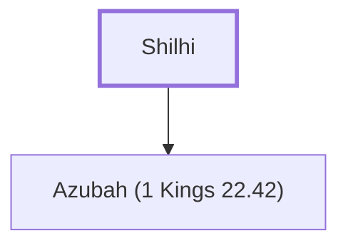

# Shilhi

Father of King Jehoshaphat's mother

**Original-language names:** שִׁלְחִי (H7977)

## When

- **Placed around:** [[connections/timeline/10th century BC|914 BC]] *(Ussher: the median date of the passages naming them)*

## Family

- **Children:** [[connections/people/Azubah (1 Kings 22.42)|Azubah (1 Kings 22.42)]]

**Family group:** [[connections/genealogy/Family of Adam|Family of Adam]], generation 1

## Appears in

[[connections/chapters/11-1-kings/1 Kings 22|1 Kings 22]] · [[connections/chapters/14-2-chronicles/2 Chronicles 20|2 Chronicles 20]]

## Appears in the same verse as

[[connections/people/Azubah (1 Kings 22.42)|Azubah (1 Kings 22.42) (2)]] · [[connections/people/Jehoshaphat (1 Kings 15.24)|Jehoshaphat (1 Kings 15.24) (2)]] · [[connections/places/Jerusalem|Jerusalem (2)]] · [[connections/people/Judah (Genesis 29.35)|Judah (Genesis 29.35)]]
