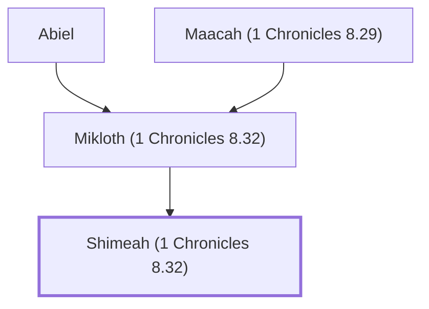

# Shimeah (1 Chronicles 8.32)

Son of Mikloth and nephew of Ner in Benjamin's genealogy.

**Also called:** Shimeam

**Original-language names:** שִׁמְאָה (H8039) · שִׁמְאָם (H8043)

## When

- **Placed around:** [[connections/timeline/12th century BC|1200 BC]] *(Ussher: the median date of the passages naming them)*

## Family

- **Father:** [[connections/people/Mikloth (1 Chronicles 8.32)|Mikloth (1 Chronicles 8.32)]]
- **Tribe or nation:** Tribe of Benjamin

**Line of descent** (6 generations, father to son): [[connections/people/Aphiah|Aphiah]] → [[connections/people/Becorath|Becorath]] → [[connections/people/Zeror|Zeror]] → [[connections/people/Abiel|Abiel]] → [[connections/people/Mikloth (1 Chronicles 8.32)|Mikloth (1 Chronicles 8.32)]] → **Shimeah (1 Chronicles 8.32)**

**Family group:** [[connections/genealogy/Family of Aphiah|Family of Aphiah]], generation 6

## Appears in

[[connections/chapters/13-1-chronicles/1 Chronicles 8|1 Chronicles 8]] · [[connections/chapters/13-1-chronicles/1 Chronicles 9|1 Chronicles 9]]

## Appears in the same verse as

[[connections/people/Mikloth (1 Chronicles 8.32)|Mikloth (1 Chronicles 8.32) (2)]] · [[connections/places/Jerusalem|Jerusalem (2)]]
