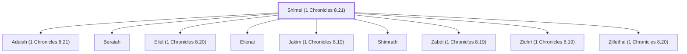

# Shimei (1 Chronicles 8.21)

Benjamite descendant of Shimei, son of Elpaal.

**Original-language names:** שִׁמְעִי (H8096)

## Family

- **Children:** [[connections/people/Adaiah (1 Chronicles 8.21)|Adaiah (1 Chronicles 8.21)]], [[connections/people/Beraiah|Beraiah]], [[connections/people/Eliel (1 Chronicles 8.20)|Eliel (1 Chronicles 8.20)]], [[connections/people/Elienai|Elienai]], [[connections/people/Jakim (1 Chronicles 8.19)|Jakim (1 Chronicles 8.19)]], [[connections/people/Shimrath|Shimrath]], [[connections/people/Zabdi (1 Chronicles 8.19)|Zabdi (1 Chronicles 8.19)]], [[connections/people/Zichri (1 Chronicles 8.19)|Zichri (1 Chronicles 8.19)]], [[connections/people/Zillethai (1 Chronicles 8.20)|Zillethai (1 Chronicles 8.20)]]
- **Tribe or nation:** Tribe of Benjamin

**Family group:** [[connections/genealogy/Family of Shimei (1 Chronicles 8.21)|Family of Shimei (1 Chronicles 8.21)]], generation 1

## Appears in

[[connections/chapters/13-1-chronicles/1 Chronicles 8|1 Chronicles 8]]

## Appears in the same verse as

[[connections/people/Adaiah (1 Chronicles 8.21)|Adaiah (1 Chronicles 8.21)]] · [[connections/people/Beraiah|Beraiah]] · [[connections/people/Shimrath|Shimrath]]
