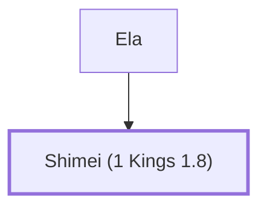

# Shimei (1 Kings 1.8)

Influential figure during Solomon's reign; son of Ela.

**Original-language names:** שִׁמְעִי (H8096)

## When

- **Placed around:** [[connections/timeline/11th century BC|1014 BC]] *(Ussher: the median date of the passages naming them)*

## Family

- **Father:** [[connections/people/Ela|Ela]]

**Family group:** [[connections/genealogy/Family of Ela|Family of Ela]], generation 2

## Appears in

[[connections/chapters/11-1-kings/1 Kings 1|1 Kings 1]] · [[connections/chapters/11-1-kings/1 Kings 4|1 Kings 4]]

## Appears in the same verse as

[[connections/people/Adonijah (2 Samuel 3.4)|Adonijah (2 Samuel 3.4)]] · [[connections/people/Benaiah (2 Samuel 8.18)|Benaiah (2 Samuel 8.18)]] · [[connections/people/Benjamin (Genesis 35.18)|Benjamin (Genesis 35.18)]] · [[connections/people/David|David]] · [[connections/people/Ela|Ela]] · [[connections/people/Jehoiada (2 Samuel 8.18)|Jehoiada (2 Samuel 8.18)]] · [[connections/people/Nathan (2 Samuel 7.2)|Nathan (2 Samuel 7.2)]] · [[connections/people/Rei|Rei]] · [[connections/people/Zadok (2 Samuel 8.17)|Zadok (2 Samuel 8.17)]]
