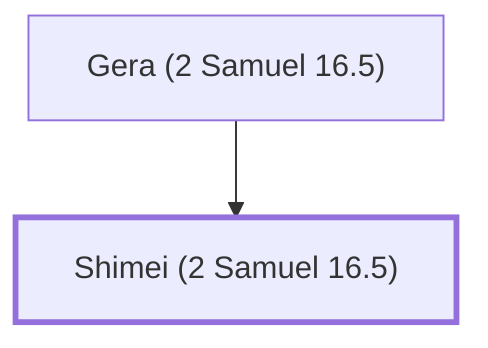

# Shimei (2 Samuel 16.5)

Benjamite who cursed David during Absalom's rebellion.

**Original-language names:** שִׁמְעִי (H8096)

## When

- **Placed around:** [[connections/timeline/11th century BC|1014 BC]] *(Ussher: the median date of the passages naming them)*

## Family

- **Father:** [[connections/people/Gera (2 Samuel 16.5)|Gera (2 Samuel 16.5)]]

**Family group:** [[connections/genealogy/Family of Gera (2 Samuel 16.5)|Family of Gera (2 Samuel 16.5)]], generation 2

## Appears in

[[connections/chapters/10-2-samuel/2 Samuel 16|2 Samuel 16 (3)]] · [[connections/chapters/10-2-samuel/2 Samuel 19|2 Samuel 19 (4)]] · [[connections/chapters/11-1-kings/1 Kings 2|1 Kings 2 (8)]]

## Appears in the same verse as

[[connections/people/David|David (4)]] · [[connections/people/Gera (2 Samuel 16.5)|Gera (2 Samuel 16.5) (4)]] · [[connections/places/Bahurim|Bahurim (3)]] · [[connections/places/Gath|Gath (3)]] · [[connections/places/Jerusalem|Jerusalem (3)]] · [[connections/people/Achish|Achish (2)]] · [[connections/places/Jordan|Jordan (2)]] · [[connections/people/Abishai|Abishai]] · [[connections/people/Judah (Genesis 29.35)|Judah (Genesis 29.35)]] · [[connections/people/Maoch|Maoch]] · [[connections/people/Saul|Saul]] · [[connections/people/Solomon|Solomon]] · [[connections/people/Zeruiah|Zeruiah]] · [[connections/places/Mahanaim|Mahanaim]]
