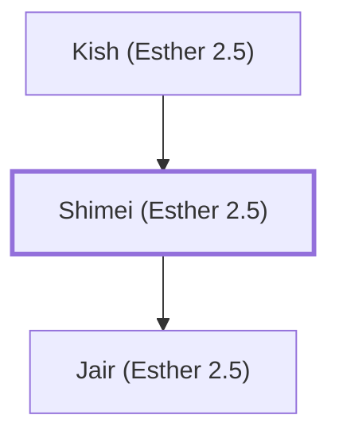

# Shimei (Esther 2.5)

Benjamite ancestor of Mordecai.

**Original-language names:** שִׁמְעִי (H8096)

## When

- **Placed around:** [[connections/timeline/5th century BC|461 BC]] *(Ussher: the median date of the passages naming them)*

## Family

- **Father:** [[connections/people/Kish (Esther 2.5)|Kish (Esther 2.5)]]
- **Children:** [[connections/people/Jair (Esther 2.5)|Jair (Esther 2.5)]]
- **Tribe or nation:** Tribe of Benjamin

**Family group:** [[connections/genealogy/Family of Kish (Esther 2.5)|Family of Kish (Esther 2.5)]], generation 2

## Appears in

[[connections/chapters/17-esther/Esther 2|Esther 2]]

## Appears in the same verse as

[[connections/people/Jair (Esther 2.5)|Jair (Esther 2.5)]] · [[connections/people/Kish (Esther 2.5)|Kish (Esther 2.5)]] · [[connections/people/Mordecai (Esther 2.5)|Mordecai (Esther 2.5)]] · [[connections/places/Susa|Susa]]
