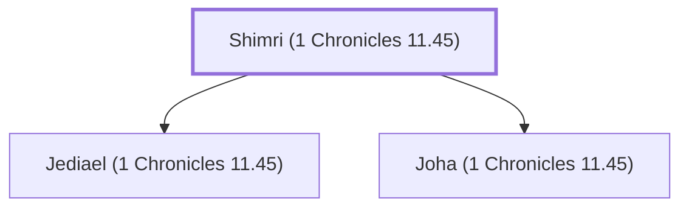

# Shimri (1 Chronicles 11.45)

One of David's mighty warriors from the tribe of Benjamin.

**Original-language names:** שִׁמְרִי (H8113)

## When

- **Placed around:** [[connections/timeline/11th century BC|1055 BC]] *(Ussher: the median date of the passages naming them)*

## Family

- **Children:** [[connections/people/Jediael (1 Chronicles 11.45)|Jediael (1 Chronicles 11.45)]], [[connections/people/Joha (1 Chronicles 11.45)|Joha (1 Chronicles 11.45)]]

**Family group:** [[connections/genealogy/Family of Shimri (1 Chronicles 11.45)|Family of Shimri (1 Chronicles 11.45)]], generation 1

## Appears in

[[connections/chapters/13-1-chronicles/1 Chronicles 11|1 Chronicles 11]]

## Appears in the same verse as

[[connections/people/Jediael (1 Chronicles 11.45)|Jediael (1 Chronicles 11.45)]] · [[connections/people/Joha (1 Chronicles 11.45)|Joha (1 Chronicles 11.45)]]
