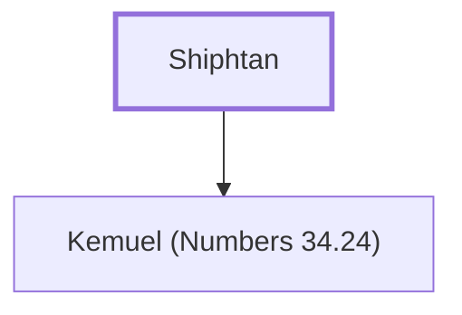

# Shiphtan

Father of Kemuel, a leader from the tribe of Ephraim.

**Original-language names:** שִׁפְטָן (H8204)

## When

- **Placed around:** [[connections/timeline/15th century BC|1452 BC]] *(Ussher: the median date of the passages naming them)*

## Family

- **Children:** [[connections/people/Kemuel (Numbers 34.24)|Kemuel (Numbers 34.24)]]

**Family group:** [[connections/genealogy/Family of Shiphtan|Family of Shiphtan]], generation 1

## Appears in

[[connections/chapters/04-numbers/Numbers 34|Numbers 34]]

## Appears in the same verse as

[[connections/people/Ephraim|Ephraim]] · [[connections/people/Kemuel (Numbers 34.24)|Kemuel (Numbers 34.24)]]
