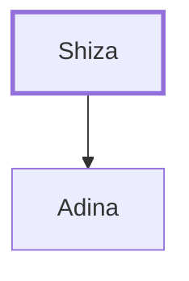

# Shiza

Reubenite father of Adina, one of David's mighty warriors.

**Original-language names:** שִׁיזָא (H7877)

## When

- **Placed around:** [[connections/timeline/11th century BC|1055 BC]] *(Ussher: the median date of the passages naming them)*

## Family

- **Children:** [[connections/people/Adina|Adina]]

**Family group:** [[connections/genealogy/Family of Shiza|Family of Shiza]], generation 1

## Appears in

[[connections/chapters/13-1-chronicles/1 Chronicles 11|1 Chronicles 11]]

## Appears in the same verse as

[[connections/people/Adina|Adina]]
