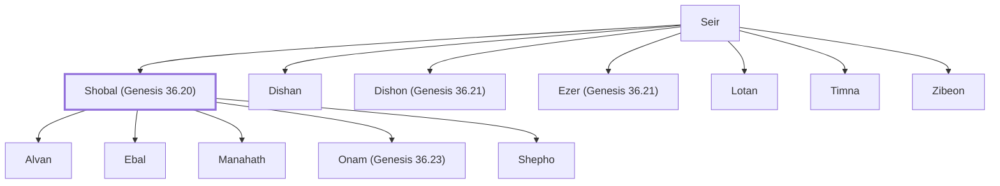

# Shobal (Genesis 36.20)

Horite chief, son of Seir, in the land of Edom.

**Original-language names:** שׁוֹבָל (H7732)

## When

- **Placed around:** [[connections/timeline/19th century BC|1806 BC]] *(Ussher: the median date of the passages naming them)*

## Family

- **Father:** [[connections/people/Seir|Seir]]
- **Brothers and sisters:** [[connections/people/Dishan|Dishan]], [[connections/people/Dishon (Genesis 36.21)|Dishon (Genesis 36.21)]], [[connections/people/Ezer (Genesis 36.21)|Ezer (Genesis 36.21)]], [[connections/people/Lotan|Lotan]], [[connections/people/Timna|Timna]], [[connections/people/Zibeon|Zibeon]]
- **Children:** [[connections/people/Alvan|Alvan]], [[connections/people/Ebal|Ebal]], [[connections/people/Manahath|Manahath]], [[connections/people/Onam (Genesis 36.23)|Onam (Genesis 36.23)]], [[connections/people/Shepho|Shepho]]
- **Tribe or nation:** Edom

**Family group:** [[connections/genealogy/Family of Adam|Family of Adam]], generation 2

## Appears in

[[connections/chapters/01-genesis/Genesis 36|Genesis 36 (3)]] · [[connections/chapters/13-1-chronicles/1 Chronicles 1|1 Chronicles 1 (2)]]

## Appears in the same verse as

[[connections/people/Anah|Anah (4)]] · [[connections/people/Lotan|Lotan (3)]] · [[connections/people/Alvan|Alvan (2)]] · [[connections/people/Ebal|Ebal (2)]] · [[connections/people/Manahath|Manahath (2)]] · [[connections/people/Onam (Genesis 36.23)|Onam (Genesis 36.23) (2)]] · [[connections/people/Seir|Seir (2)]] · [[connections/people/Shepho|Shepho (2)]] · [[connections/people/Aiah (Genesis 36.24)|Aiah (Genesis 36.24)]] · [[connections/people/Dishan|Dishan]] · [[connections/people/Dishon (Genesis 36.21)|Dishon (Genesis 36.21)]] · [[connections/people/Ezer (Genesis 36.21)|Ezer (Genesis 36.21)]]
