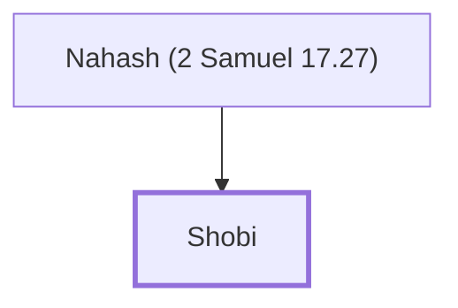

# Shobi

Ammonite who provided supplies to David at Mahanaim.

**Original-language names:** שֹׁבִי (H7629)

## When

- **Placed around:** [[connections/timeline/11th century BC|1023 BC]] *(Ussher: the median date of the passages naming them)*

## Family

- **Father:** [[connections/people/Nahash (2 Samuel 17.27)|Nahash (2 Samuel 17.27)]]
- **Tribe or nation:** Ammon

**Family group:** [[connections/genealogy/Family of Nahash (2 Samuel 17.27)|Family of Nahash (2 Samuel 17.27)]], generation 2

## Appears in

[[connections/chapters/10-2-samuel/2 Samuel 17|2 Samuel 17]]

## Appears in the same verse as

[[connections/people/Ammiel (2 Samuel 9.4)|Ammiel (2 Samuel 9.4)]] · [[connections/people/Barzillai (2 Samuel 17.27)|Barzillai (2 Samuel 17.27)]] · [[connections/people/David|David]] · [[connections/people/Machir (2 Samuel 9.4)|Machir (2 Samuel 9.4)]] · [[connections/people/Nahash (2 Samuel 17.27)|Nahash (2 Samuel 17.27)]] · [[connections/places/Ammon|Ammon]] · [[connections/places/Lo-debar|Lo-debar]] · [[connections/places/Mahanaim|Mahanaim]] · [[connections/places/Rogelim|Rogelim]]
