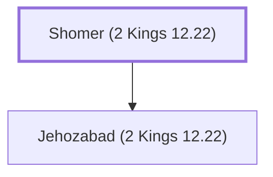

# Shomer (2 Kings 12.22)

Moabite mother of an assassin of King Joash.

**Also called:** Shimrith

**Original-language names:** שֹׁמֵר (H7763) · שִׁמְרִית (H8116)

## When

- **Placed around:** [[connections/timeline/9th century BC|839 BC]] *(Ussher: the median date of the passages naming them)*

## Family

- **Children:** [[connections/people/Jehozabad (2 Kings 12.22)|Jehozabad (2 Kings 12.22)]]
- **Tribe or nation:** Moab

**Family group:** [[connections/genealogy/Family of Shomer (2 Kings 12.22)|Family of Shomer (2 Kings 12.22)]], generation 1

## Appears in

[[connections/chapters/12-2-kings/2 Kings 12|2 Kings 12]] · [[connections/chapters/14-2-chronicles/2 Chronicles 24|2 Chronicles 24]]

## Appears in the same verse as

[[connections/people/Jehozabad (2 Kings 12.22)|Jehozabad (2 Kings 12.22) (2)]] · [[connections/people/Jozacar|Jozacar (2)]] · [[connections/people/Shimeath|Shimeath (2)]] · [[connections/people/Amaziah (2 Kings 12.22)|Amaziah (2 Kings 12.22)]] · [[connections/people/David|David]] · [[connections/places/Moab|Moab]]
