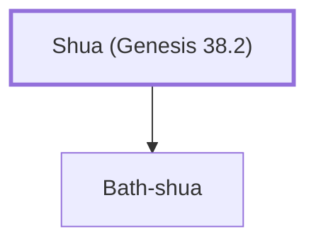

# Shua (Genesis 38.2)

Father of Canaanite wife of Judah, mother of Er, Onan, and Shelah.

**Original-language names:** שׁוּעַ (H7770)

## When

- **Placed around:** [[connections/timeline/18th century BC|1739 BC]] *(Ussher: the median date of the passages naming them)*

## Family

- **Children:** [[connections/people/Bath-shua|Bath-shua]]

**Family group:** [[connections/genealogy/Family of Adam|Family of Adam]], generation 1

## Appears in

[[connections/chapters/01-genesis/Genesis 38|Genesis 38 (2)]] · [[connections/chapters/13-1-chronicles/1 Chronicles 2|1 Chronicles 2]]

## Appears in the same verse as

[[connections/people/Judah (Genesis 29.35)|Judah (Genesis 29.35) (3)]] · [[connections/people/Bath-shua|Bath-shua (2)]] · [[connections/people/Er (Genesis 38.3)|Er (Genesis 38.3)]] · [[connections/people/Hirah|Hirah]] · [[connections/people/Onan|Onan]] · [[connections/people/Shelah (Genesis 38.5)|Shelah (Genesis 38.5)]] · [[connections/places/Timnah (Genesis 38.12)|Timnah (Genesis 38.12)]]
