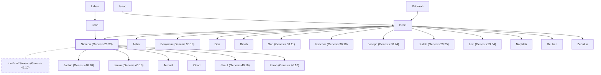

# Simeon (Genesis 29.33)

Son of Jacob and Leah, one of the twelve tribes.

**Original-language names:** שִׁמְעוֹן (H8095) · שִׁמְעֹנִי (H8099) · Συμεών (G4826)

## When

- **Lived:** [[connections/timeline/18th century BC|1757 BC]] – ? *(Jones)*
- **Placed around:** [[connections/timeline/15th century BC|1490 BC]] *(Ussher: the median date of the passages naming them)*

## Family

- **Father:** [[connections/people/Israel|Israel]]
- **Mother:** [[connections/people/Leah|Leah]]
- **Brothers and sisters:** [[connections/people/Asher|Asher]], [[connections/people/Benjamin (Genesis 35.18)|Benjamin (Genesis 35.18)]], [[connections/people/Dan|Dan]], [[connections/people/Dinah|Dinah]], [[connections/people/Gad (Genesis 30.11)|Gad (Genesis 30.11)]], [[connections/people/Issachar (Genesis 30.18)|Issachar (Genesis 30.18)]], [[connections/people/Joseph (Genesis 30.24)|Joseph (Genesis 30.24)]], [[connections/people/Judah (Genesis 29.35)|Judah (Genesis 29.35)]], [[connections/people/Levi (Genesis 29.34)|Levi (Genesis 29.34)]], [[connections/people/Naphtali|Naphtali]], [[connections/people/Reuben|Reuben]], [[connections/people/Zebulun|Zebulun]]
- **Spouses:** [[connections/people/a wife of Simeon (Genesis 46.10)|a wife of Simeon (Genesis 46.10)]]
- **Children:** [[connections/people/Jachin (Genesis 46.10)|Jachin (Genesis 46.10)]], [[connections/people/Jamin (Genesis 46.10)|Jamin (Genesis 46.10)]], [[connections/people/Jemuel|Jemuel]], [[connections/people/Ohad|Ohad]], [[connections/people/Shaul (Genesis 46.10)|Shaul (Genesis 46.10)]], [[connections/people/Zerah (Genesis 46.10)|Zerah (Genesis 46.10)]]
- **Tribe or nation:** Tribe of Simeon

**Line of descent** (24 generations, father to son): [[connections/people/Adam|Adam]] → [[connections/people/Seth|Seth]] → [[connections/people/Enosh|Enosh]] → [[connections/people/Kenan|Kenan]] → [[connections/people/Mahalalel (Genesis 5.12)|Mahalalel (Genesis 5.12)]] → [[connections/people/Jared|Jared]] → [[connections/people/Enoch (Genesis 5.18)|Enoch (Genesis 5.18)]] → [[connections/people/Methuselah|Methuselah]] → [[connections/people/Lamech (Genesis 5.25)|Lamech (Genesis 5.25)]] → [[connections/people/Noah (Genesis 5.29)|Noah (Genesis 5.29)]] → [[connections/people/Shem|Shem]] → [[connections/people/Arpachshad|Arpachshad]] → [[connections/people/Cainan|Cainan]] → [[connections/people/Shelah (Genesis 10.24)|Shelah (Genesis 10.24)]] → [[connections/people/Eber (Genesis 10.21)|Eber (Genesis 10.21)]] → [[connections/people/Peleg|Peleg]] → [[connections/people/Reu|Reu]] → [[connections/people/Serug|Serug]] → [[connections/people/Nahor (Genesis 11.22)|Nahor (Genesis 11.22)]] → [[connections/people/Terah|Terah]] → [[connections/people/Abraham|Abraham]] → [[connections/people/Isaac|Isaac]] → [[connections/people/Israel|Israel]] → **Simeon (Genesis 29.33)**

**Family group:** [[connections/genealogy/Family of Adam|Family of Adam]], generation 24

## Events

- [[connections/timeline/18th century BC|1757 BC]] · [[connections/events/Birth of Simeon|Birth of Simeon]]
- [[connections/timeline/18th century BC|1728 BC]] · [[connections/events/Joseph sold to Egypt|Joseph sold to Egypt]]
- [[connections/timeline/18th century BC|1708 BC]] · [[connections/events/7 years of famine|7 years of famine]]
- [[connections/timeline/18th century BC|1706 BC]] · [[connections/events/Joseph's brothers return to Egypt|Joseph's brothers return to Egypt]]

## Appears in

[[connections/chapters/01-genesis/Genesis 29|Genesis 29]] · [[connections/chapters/01-genesis/Genesis 34|Genesis 34 (2)]] · [[connections/chapters/01-genesis/Genesis 35|Genesis 35]] · [[connections/chapters/01-genesis/Genesis 42|Genesis 42 (2)]] · [[connections/chapters/01-genesis/Genesis 43|Genesis 43]] · [[connections/chapters/01-genesis/Genesis 46|Genesis 46]] · [[connections/chapters/01-genesis/Genesis 48|Genesis 48]] · [[connections/chapters/01-genesis/Genesis 49|Genesis 49]] · [[connections/chapters/02-exodus/Exodus 1|Exodus 1]] · [[connections/chapters/02-exodus/Exodus 6|Exodus 6]] · [[connections/chapters/04-numbers/Numbers 1|Numbers 1 (3)]] · [[connections/chapters/04-numbers/Numbers 2|Numbers 2]] · [[connections/chapters/04-numbers/Numbers 7|Numbers 7]] · [[connections/chapters/04-numbers/Numbers 10|Numbers 10]] · [[connections/chapters/04-numbers/Numbers 13|Numbers 13]] · [[connections/chapters/04-numbers/Numbers 25|Numbers 25]] · [[connections/chapters/04-numbers/Numbers 26|Numbers 26 (2)]] · [[connections/chapters/04-numbers/Numbers 34|Numbers 34]] · [[connections/chapters/05-deuteronomy/Deuteronomy 27|Deuteronomy 27]] · [[connections/chapters/06-joshua/Joshua 19|Joshua 19 (3)]] · [[connections/chapters/06-joshua/Joshua 21|Joshua 21 (2)]] · [[connections/chapters/07-judges/Judges 1|Judges 1 (2)]] · [[connections/chapters/13-1-chronicles/1 Chronicles 2|1 Chronicles 2]] · [[connections/chapters/13-1-chronicles/1 Chronicles 4|1 Chronicles 4 (2)]] · [[connections/chapters/13-1-chronicles/1 Chronicles 6|1 Chronicles 6]] · [[connections/chapters/13-1-chronicles/1 Chronicles 12|1 Chronicles 12]] · [[connections/chapters/13-1-chronicles/1 Chronicles 27|1 Chronicles 27]] · [[connections/chapters/14-2-chronicles/2 Chronicles 15|2 Chronicles 15]] · [[connections/chapters/14-2-chronicles/2 Chronicles 34|2 Chronicles 34]] · [[connections/chapters/26-ezekiel/Ezekiel 48|Ezekiel 48 (3)]] · [[connections/chapters/66-revelation/Revelation 7|Revelation 7]]

## Appears in the same verse as

[[connections/people/Judah (Genesis 29.35)|Judah (Genesis 29.35) (12)]] · [[connections/people/Levi (Genesis 29.34)|Levi (Genesis 29.34) (8)]] · [[connections/people/Israel|Israel (7)]] · [[connections/people/Benjamin (Genesis 35.18)|Benjamin (Genesis 35.18) (6)]] · [[connections/people/Issachar (Genesis 30.18)|Issachar (Genesis 30.18) (6)]] · [[connections/people/Jachin (Genesis 46.10)|Jachin (Genesis 46.10) (4)]] · [[connections/people/Jamin (Genesis 46.10)|Jamin (Genesis 46.10) (4)]] · [[connections/people/Jemuel|Jemuel (4)]] · [[connections/people/Reuben|Reuben (4)]] · [[connections/people/Shelumiel|Shelumiel (4)]] · [[connections/people/Zurishaddai|Zurishaddai (4)]] · [[connections/people/Ephraim|Ephraim (3)]] · [[connections/people/Manasseh (Genesis 41.51)|Manasseh (Genesis 41.51) (3)]] · [[connections/people/Shaul (Genesis 46.10)|Shaul (Genesis 46.10) (3)]] · [[connections/people/Zebulun|Zebulun (3)]] · [[connections/people/Zerah (Genesis 46.10)|Zerah (Genesis 46.10) (3)]] · [[connections/people/Joseph (Genesis 30.24)|Joseph (Genesis 30.24) (2)]] · [[connections/people/Ohad|Ohad (2)]] · [[connections/people/Aaron|Aaron]] · [[connections/people/Ammihud (Numbers 34.20)|Ammihud (Numbers 34.20)]] · [[connections/people/Dinah|Dinah]] · [[connections/people/Eliezer (1 Chronicles 27.16)|Eliezer (1 Chronicles 27.16)]] · [[connections/people/Hori (Numbers 13.5)|Hori (Numbers 13.5)]] · [[connections/people/Ishi (1 Chronicles 4.42)|Ishi (1 Chronicles 4.42)]] · [[connections/people/Leah|Leah]] · [[connections/people/Maacah (1 Chronicles 27.16)|Maacah (1 Chronicles 27.16)]] · [[connections/people/Naphtali|Naphtali]] · [[connections/people/Neariah (1 Chronicles 4.42)|Neariah (1 Chronicles 4.42)]] · [[connections/people/Pelatiah (1 Chronicles 4.42)|Pelatiah (1 Chronicles 4.42)]] · [[connections/people/Rephaiah (1 Chronicles 4.42)|Rephaiah (1 Chronicles 4.42)]] · [[connections/people/Salu|Salu]] · [[connections/people/Shaphat (Numbers 13.5)|Shaphat (Numbers 13.5)]] · [[connections/people/Shemuel (Numbers 34.20)|Shemuel (Numbers 34.20)]] · [[connections/people/Shephatiah (1 Chronicles 27.16)|Shephatiah (1 Chronicles 27.16)]] · [[connections/people/Uzziel (1 Chronicles 4.42)|Uzziel (1 Chronicles 4.42)]] · [[connections/people/Zichri (1 Chronicles 27.16)|Zichri (1 Chronicles 27.16)]] · [[connections/people/Zimri (Numbers 25.14)|Zimri (Numbers 25.14)]] · [[connections/places/Baalath-beer|Baalath-beer]] · [[connections/places/Egypt|Egypt]] · [[connections/places/Gerizim Mount|Gerizim Mount]] · [[connections/places/Hormah|Hormah]] · [[connections/places/Jordan|Jordan]] · [[connections/places/Negeb|Negeb]] · [[connections/places/Ramah (Joshua 18.25)|Ramah (Joshua 18.25)]] · [[connections/places/Seir Mount (Deuteronomy 1.2)|Seir Mount (Deuteronomy 1.2)]]
