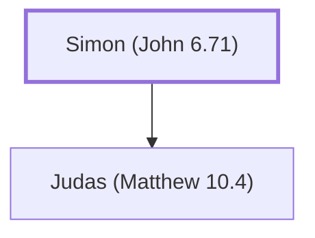

# Simon (John 6.71)

Father of Judas Iscariot, the disciple who betrayed Jesus.

**Original-language names:** Σίμων (G4613)

## When

- **Placed around:** [[connections/timeline/1st century AD|AD 33]] *(Ussher: the median date of the passages naming them)*

## Family

- **Children:** [[connections/people/Judas (Matthew 10.4)|Judas (Matthew 10.4)]]

**Family group:** [[connections/genealogy/Family of Simon (John 6.71)|Family of Simon (John 6.71)]], generation 1

## Appears in

[[connections/chapters/43-john/John 6|John 6]] · [[connections/chapters/43-john/John 12|John 12]] · [[connections/chapters/43-john/John 13|John 13 (2)]]

## Appears in the same verse as

[[connections/people/Judas (Matthew 10.4)|Judas (Matthew 10.4) (4)]] · [[connections/people/Jesus|Jesus]]
