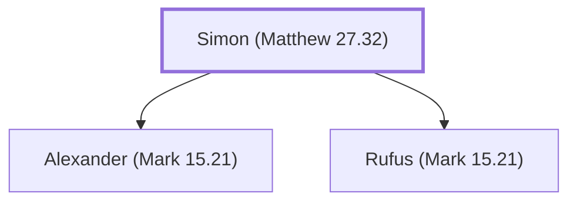

# Simon (Matthew 27.32)

A man who carried Jesus' cross on the way to crucifixion.

**Original-language names:** Σίμων (G4613)

## When

- **Placed around:** [[connections/timeline/1st century AD|AD 33]] *(Ussher: the median date of the passages naming them)*

## Family

- **Children:** [[connections/people/Alexander (Mark 15.21)|Alexander (Mark 15.21)]], [[connections/people/Rufus (Mark 15.21)|Rufus (Mark 15.21)]]

**Family group:** [[connections/genealogy/Family of Simon (Matthew 27.32)|Family of Simon (Matthew 27.32)]], generation 1

## Events

- [[connections/timeline/1st century AD|AD 30]] · [[connections/events/Bearing Cross to Golgotha|Bearing Cross to Golgotha]]

## Appears in

[[connections/chapters/40-matthew/Matthew 27|Matthew 27]] · [[connections/chapters/41-mark/Mark 15|Mark 15]] · [[connections/chapters/42-luke/Luke 23|Luke 23]]

## Appears in the same verse as

[[connections/places/Cyrene|Cyrene (3)]] · [[connections/people/Alexander (Mark 15.21)|Alexander (Mark 15.21)]] · [[connections/people/Jesus|Jesus]] · [[connections/people/Rufus (Mark 15.21)|Rufus (Mark 15.21)]]
