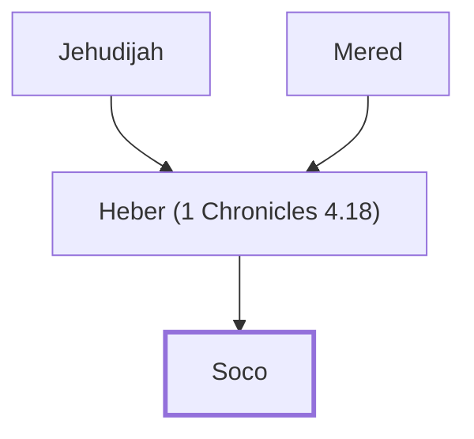

# Soco

Son of Heber, from the tribe of Judah.

**Original-language names:** שׂוֹכֹוֹ (H7755)

## When

- **Placed around:** [[connections/timeline/18th century BC|1721 BC]] *(Ussher: the median date of the passages naming them)*

## Family

- **Father:** [[connections/people/Heber (1 Chronicles 4.18)|Heber (1 Chronicles 4.18)]]
- **Tribe or nation:** Tribe of Judah(?)

**Line of descent** (4 generations, father to son): [[connections/people/Ezrah|Ezrah]] → [[connections/people/Mered|Mered]] → [[connections/people/Heber (1 Chronicles 4.18)|Heber (1 Chronicles 4.18)]] → **Soco**

**Family group:** [[connections/genealogy/Family of Adam|Family of Adam]], generation 4

## Appears in

[[connections/chapters/13-1-chronicles/1 Chronicles 4|1 Chronicles 4]]

## Appears in the same verse as

[[connections/people/Bithiah|Bithiah]] · [[connections/people/Heber (1 Chronicles 4.18)|Heber (1 Chronicles 4.18)]] · [[connections/people/Jehudijah|Jehudijah]] · [[connections/people/Jekuthiel|Jekuthiel]] · [[connections/people/Jered|Jered]] · [[connections/people/Mered|Mered]] · [[connections/people/Pharaoh (1 Chronicles 4.18)|Pharaoh (1 Chronicles 4.18)]] · [[connections/places/Gedor (Joshua 12.13)|Gedor (Joshua 12.13)]] · [[connections/places/Zanoah (Joshua 15.34)|Zanoah (Joshua 15.34)]]
