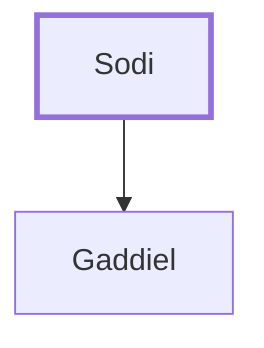

# Sodi

Father of the Zebulunite spy Gaddiel.

**Original-language names:** סוֹדִי (H5476)

## When

- **Placed around:** [[connections/timeline/15th century BC|1490 BC]] *(Ussher: the median date of the passages naming them)*

## Family

- **Children:** [[connections/people/Gaddiel|Gaddiel]]

**Family group:** [[connections/genealogy/Family of Sodi|Family of Sodi]], generation 1

## Appears in

[[connections/chapters/04-numbers/Numbers 13|Numbers 13]]

## Appears in the same verse as

[[connections/people/Gaddiel|Gaddiel]] · [[connections/people/Zebulun|Zebulun]]
