# Solomon

Son of David, king of Israel, known for his wisdom.

**Also called:** Jedidiah

**Original-language names:** שְׁלֹמֹה (H8010) · יְדִידְיָה (H3041) · Σολομών, Σαλωμών (G4672)

## When

- **Lived:** [[connections/timeline/11th century BC|1036 BC]] – [[connections/timeline/10th century BC|975 BC]] *(Jones)*
- **Placed around:** [[connections/timeline/11th century BC|1014 BC]] *(Ussher: the median date of the passages naming them)*

## Family

- **Father:** [[connections/people/David|David]]
- **Mother:** [[connections/people/Bathsheba|Bathsheba]]
- **Brothers and sisters:** [[connections/people/Absalom|Absalom]], [[connections/people/Adonijah (2 Samuel 3.4)|Adonijah (2 Samuel 3.4)]], [[connections/people/Amnon (2 Samuel 3.2)|Amnon (2 Samuel 3.2)]], [[connections/people/Chileab|Chileab]], [[connections/people/Eliada (2 Samuel 5.16)|Eliada (2 Samuel 5.16)]], [[connections/people/Eliphelet (2 Samuel 5.16)|Eliphelet (2 Samuel 5.16)]], [[connections/people/Elishama (2 Samuel 5.16)|Elishama (2 Samuel 5.16)]], [[connections/people/Elishua|Elishua]], [[connections/people/Elpelet|Elpelet]], [[connections/people/Ibhar|Ibhar]], [[connections/people/Ithream|Ithream]], [[connections/people/Japhia (2 Samuel 5.15)|Japhia (2 Samuel 5.15)]], [[connections/people/Jerimoth (2 Chronicles 11.18)|Jerimoth (2 Chronicles 11.18)]], [[connections/people/Nathan (2 Samuel 5.14)|Nathan (2 Samuel 5.14)]], [[connections/people/Nepheg (2 Samuel 5.15)|Nepheg (2 Samuel 5.15)]], [[connections/people/Nogah|Nogah]], [[connections/people/Shammua (2 Samuel 5.14)|Shammua (2 Samuel 5.14)]], [[connections/people/Shephatiah (2 Samuel 3.4)|Shephatiah (2 Samuel 3.4)]], [[connections/people/Shobab (2 Samuel 5.14)|Shobab (2 Samuel 5.14)]], [[connections/people/Tamar (2 Samuel 13.1)|Tamar (2 Samuel 13.1)]]
- **Spouses:** [[connections/people/Naamah (1 Kings 14.21)|Naamah (1 Kings 14.21)]], [[connections/people/daughter of Pharaoh (1 Kings 3.1)|daughter of Pharaoh (1 Kings 3.1)]], [[connections/people/a wife of Solomon (1 Kings 4.11)|a wife of Solomon (1 Kings 4.11)]]
- **Children:** [[connections/people/Basemath|Basemath]], [[connections/people/Rehoboam|Rehoboam]], [[connections/people/Taphath|Taphath]]
- **Tribe or nation:** Tribe of Judah

**Line of descent** (35 generations, father to son): [[connections/people/Adam|Adam]] → [[connections/people/Seth|Seth]] → [[connections/people/Enosh|Enosh]] → [[connections/people/Kenan|Kenan]] → [[connections/people/Mahalalel (Genesis 5.12)|Mahalalel (Genesis 5.12)]] → [[connections/people/Jared|Jared]] → [[connections/people/Enoch (Genesis 5.18)|Enoch (Genesis 5.18)]] → [[connections/people/Methuselah|Methuselah]] → [[connections/people/Lamech (Genesis 5.25)|Lamech (Genesis 5.25)]] → [[connections/people/Noah (Genesis 5.29)|Noah (Genesis 5.29)]] → [[connections/people/Shem|Shem]] → [[connections/people/Arpachshad|Arpachshad]] → [[connections/people/Cainan|Cainan]] → [[connections/people/Shelah (Genesis 10.24)|Shelah (Genesis 10.24)]] → [[connections/people/Eber (Genesis 10.21)|Eber (Genesis 10.21)]] → [[connections/people/Peleg|Peleg]] → [[connections/people/Reu|Reu]] → [[connections/people/Serug|Serug]] → [[connections/people/Nahor (Genesis 11.22)|Nahor (Genesis 11.22)]] → [[connections/people/Terah|Terah]] → [[connections/people/Abraham|Abraham]] → [[connections/people/Isaac|Isaac]] → [[connections/people/Israel|Israel]] → [[connections/people/Judah (Genesis 29.35)|Judah (Genesis 29.35)]] → [[connections/people/Perez|Perez]] → [[connections/people/Hezron (Genesis 46.12)|Hezron (Genesis 46.12)]] → [[connections/people/Ram (Ruth 4.19)|Ram (Ruth 4.19)]] → [[connections/people/Amminadab (Exodus 6.23)|Amminadab (Exodus 6.23)]] → [[connections/people/Nahshon|Nahshon]] → [[connections/people/Salmon|Salmon]] → [[connections/people/Boaz|Boaz]] → [[connections/people/Obed (Ruth 4.17)|Obed (Ruth 4.17)]] → [[connections/people/Jesse|Jesse]] → [[connections/people/David|David]] → **Solomon**

**Family group:** [[connections/genealogy/Family of Adam|Family of Adam]], generation 35

```mermaid
flowchart TB
  n0["Solomon"]:::me
  n1["Eliam (2 Samuel 11.3)"]
  n2["Bathsheba"]
  n1 --> n2
  n2 --> n0
  n3["Jesse"]
  n4["David"]
  n3 --> n4
  n5["Nahash (2 Samuel 17.25)"]
  n5 --> n4
  n4 --> n0
  n6["Absalom"]
  n4 --> n6
  n7["Adonijah (2 Samuel 3.4)"]
  n4 --> n7
  n8["Amnon (2 Samuel 3.2)"]
  n4 --> n8
  n9["Chileab"]
  n4 --> n9
  n10["Eliada (2 Samuel 5.16)"]
  n4 --> n10
  n11["Eliphelet (2 Samuel 5.16)"]
  n4 --> n11
  n12["Elishama (2 Samuel 5.16)"]
  n4 --> n12
  n13["Elishua"]
  n4 --> n13
  n14["Elpelet"]
  n4 --> n14
  n15["Ibhar"]
  n4 --> n15
  n16["Ithream"]
  n4 --> n16
  n17["Japhia (2 Samuel 5.15)"]
  n4 --> n17
  n18["Jerimoth (2 Chronicles 11.18)"]
  n4 --> n18
  n19["Nathan (2 Samuel 5.14)"]
  n2 --> n19
  n20["Nepheg (2 Samuel 5.15)"]
  n4 --> n20
  n21["Nogah"]
  n4 --> n21
  n22["Shammua (2 Samuel 5.14)"]
  n2 --> n22
  n23["Shephatiah (2 Samuel 3.4)"]
  n4 --> n23
  n24["Shobab (2 Samuel 5.14)"]
  n2 --> n24
  n25["Tamar (2 Samuel 13.1)"]
  n4 --> n25
  n26["Naamah (1 Kings 14.21)"]:::spouse
  n0 -.- n26
  n27["daughter of Pharaoh (1 Kings 3.1)"]:::spouse
  n0 -.- n27
  n28["a wife of Solomon (1 Kings 4.11)"]:::spouse
  n0 -.- n28
  n29["Basemath"]
  n0 --> n29
  n30["Rehoboam"]
  n0 --> n30
  n31["Taphath"]
  n0 --> n31
  classDef me stroke-width:3px
  classDef spouse stroke-dasharray:4
```

## Events

- [[connections/timeline/11th century BC|1015 BC]] · [[connections/events/Reign of Solomon|Reign of Solomon]]
- [[connections/timeline/10th century BC|975 BC]] · [[connections/events/Death of Solomon|Death of Solomon]]

## Appears in

[[connections/chapters/10-2-samuel/2 Samuel 5|2 Samuel 5]] · [[connections/chapters/10-2-samuel/2 Samuel 12|2 Samuel 12 (2)]] · [[connections/chapters/11-1-kings/1 Kings 1|1 Kings 1 (21)]] · [[connections/chapters/11-1-kings/1 Kings 2|1 Kings 2 (13)]] · [[connections/chapters/11-1-kings/1 Kings 3|1 Kings 3 (7)]] · [[connections/chapters/11-1-kings/1 Kings 4|1 Kings 4 (4)]] · [[connections/chapters/11-1-kings/1 Kings 5|1 Kings 5 (19)]] · [[connections/chapters/11-1-kings/1 Kings 6|1 Kings 6 (5)]] · [[connections/chapters/11-1-kings/1 Kings 7|1 Kings 7 (9)]] · [[connections/chapters/11-1-kings/1 Kings 8|1 Kings 8 (8)]] · [[connections/chapters/11-1-kings/1 Kings 9|1 Kings 9 (16)]] · [[connections/chapters/11-1-kings/1 Kings 10|1 Kings 10 (13)]] · [[connections/chapters/11-1-kings/1 Kings 11|1 Kings 11 (18)]] · [[connections/chapters/11-1-kings/1 Kings 12|1 Kings 12 (4)]] · [[connections/chapters/11-1-kings/1 Kings 14|1 Kings 14 (2)]] · [[connections/chapters/12-2-kings/2 Kings 21|2 Kings 21]] · [[connections/chapters/12-2-kings/2 Kings 23|2 Kings 23]] · [[connections/chapters/12-2-kings/2 Kings 24|2 Kings 24]] · [[connections/chapters/12-2-kings/2 Kings 25|2 Kings 25]] · [[connections/chapters/13-1-chronicles/1 Chronicles 3|1 Chronicles 3 (2)]] · [[connections/chapters/13-1-chronicles/1 Chronicles 5|1 Chronicles 5]] · [[connections/chapters/13-1-chronicles/1 Chronicles 6|1 Chronicles 6]] · [[connections/chapters/13-1-chronicles/1 Chronicles 14|1 Chronicles 14]] · [[connections/chapters/13-1-chronicles/1 Chronicles 18|1 Chronicles 18]] · [[connections/chapters/13-1-chronicles/1 Chronicles 22|1 Chronicles 22 (5)]] · [[connections/chapters/13-1-chronicles/1 Chronicles 23|1 Chronicles 23]] · [[connections/chapters/13-1-chronicles/1 Chronicles 28|1 Chronicles 28 (5)]] · [[connections/chapters/13-1-chronicles/1 Chronicles 29|1 Chronicles 29 (7)]] · [[connections/chapters/14-2-chronicles/2 Chronicles 1|2 Chronicles 1 (12)]] · [[connections/chapters/14-2-chronicles/2 Chronicles 2|2 Chronicles 2 (4)]] · [[connections/chapters/14-2-chronicles/2 Chronicles 3|2 Chronicles 3 (2)]] · [[connections/chapters/14-2-chronicles/2 Chronicles 4|2 Chronicles 4 (4)]] · [[connections/chapters/14-2-chronicles/2 Chronicles 5|2 Chronicles 5 (3)]] · [[connections/chapters/14-2-chronicles/2 Chronicles 6|2 Chronicles 6 (2)]] · [[connections/chapters/14-2-chronicles/2 Chronicles 7|2 Chronicles 7 (7)]] · [[connections/chapters/14-2-chronicles/2 Chronicles 8|2 Chronicles 8 (12)]] · [[connections/chapters/14-2-chronicles/2 Chronicles 9|2 Chronicles 9 (17)]] · [[connections/chapters/14-2-chronicles/2 Chronicles 10|2 Chronicles 10 (2)]] · [[connections/chapters/14-2-chronicles/2 Chronicles 11|2 Chronicles 11 (2)]] · [[connections/chapters/14-2-chronicles/2 Chronicles 12|2 Chronicles 12]] · [[connections/chapters/14-2-chronicles/2 Chronicles 13|2 Chronicles 13 (2)]] · [[connections/chapters/14-2-chronicles/2 Chronicles 30|2 Chronicles 30]] · [[connections/chapters/14-2-chronicles/2 Chronicles 33|2 Chronicles 33]] · [[connections/chapters/14-2-chronicles/2 Chronicles 35|2 Chronicles 35 (2)]] · [[connections/chapters/15-ezra/Ezra 2|Ezra 2 (2)]] · [[connections/chapters/16-nehemiah/Nehemiah 7|Nehemiah 7 (2)]] · [[connections/chapters/16-nehemiah/Nehemiah 11|Nehemiah 11]] · [[connections/chapters/16-nehemiah/Nehemiah 12|Nehemiah 12]] · [[connections/chapters/16-nehemiah/Nehemiah 13|Nehemiah 13]] · [[connections/chapters/19-psalms/Psalms 72|Psalms 72]] · [[connections/chapters/19-psalms/Psalms 127|Psalms 127]] · [[connections/chapters/20-proverbs/Proverbs 1|Proverbs 1]] · [[connections/chapters/20-proverbs/Proverbs 10|Proverbs 10]] · [[connections/chapters/20-proverbs/Proverbs 25|Proverbs 25]] · [[connections/chapters/22-song-of-songs/Song of Songs 1|Song of Songs 1 (2)]] · [[connections/chapters/22-song-of-songs/Song of Songs 3|Song of Songs 3 (3)]] · [[connections/chapters/22-song-of-songs/Song of Songs 8|Song of Songs 8 (2)]] · [[connections/chapters/24-jeremiah/Jeremiah 52|Jeremiah 52]] · [[connections/chapters/40-matthew/Matthew 1|Matthew 1 (2)]] · [[connections/chapters/40-matthew/Matthew 6|Matthew 6]] · [[connections/chapters/40-matthew/Matthew 12|Matthew 12]] · [[connections/chapters/42-luke/Luke 11|Luke 11]] · [[connections/chapters/42-luke/Luke 12|Luke 12]] · [[connections/chapters/43-john/John 10|John 10]] · [[connections/chapters/44-acts/Acts 7|Acts 7]]

## Appears in the same verse as

[[connections/people/Israel|Israel (54)]] · [[connections/people/David|David (52)]] · [[connections/places/Jerusalem|Jerusalem (33)]] · [[connections/people/Hiram (2 Samuel 5.11)|Hiram (2 Samuel 5.11) (16)]] · [[connections/people/Rehoboam|Rehoboam (12)]] · [[connections/places/Egypt|Egypt (12)]] · [[connections/people/Queen of Sheba|Queen of Sheba (10)]] · [[connections/people/Adonijah (2 Samuel 3.4)|Adonijah (2 Samuel 3.4) (9)]] · [[connections/people/Jeroboam (1 Kings 11.26)|Jeroboam (1 Kings 11.26) (8)]] · [[connections/people/Judah (Genesis 29.35)|Judah (Genesis 29.35) (8)]] · [[connections/places/Sheba|Sheba (8)]] · [[connections/people/Benaiah (2 Samuel 8.18)|Benaiah (2 Samuel 8.18) (6)]] · [[connections/people/Nathan (2 Samuel 7.2)|Nathan (2 Samuel 7.2) (6)]] · [[connections/places/Tyre|Tyre (6)]] · [[connections/people/Bathsheba|Bathsheba (5)]] · [[connections/people/Hiram (1 Kings 7.13)|Hiram (1 Kings 7.13) (5)]] · [[connections/people/Jehoiada (2 Samuel 8.18)|Jehoiada (2 Samuel 8.18) (5)]] · [[connections/people/Nebat|Nebat (5)]] · [[connections/people/Pharaoh (1 Kings 3.1)|Pharaoh (1 Kings 3.1) (5)]] · [[connections/people/Zadok (2 Samuel 8.17)|Zadok (2 Samuel 8.17) (5)]] · [[connections/places/Gibeon|Gibeon (5)]] · [[connections/people/Abiathar|Abiathar (3)]] · [[connections/people/Benjamin (Genesis 35.18)|Benjamin (Genesis 35.18) (3)]] · [[connections/people/Joab (1 Samuel 26.6)|Joab (1 Samuel 26.6) (3)]] · [[connections/people/Nathan (2 Samuel 5.14)|Nathan (2 Samuel 5.14) (3)]] · [[connections/people/Shammua (2 Samuel 5.14)|Shammua (2 Samuel 5.14) (3)]] · [[connections/people/Shobab (2 Samuel 5.14)|Shobab (2 Samuel 5.14) (3)]] · [[connections/places/Edom|Edom (3)]] · [[connections/places/Gezer|Gezer (3)]] · [[connections/places/Lebanon|Lebanon (3)]] · [[connections/places/Moab|Moab (3)]] · [[connections/places/Ophir|Ophir (3)]] · [[connections/people/Abijah (1 Kings 14.31)|Abijah (1 Kings 14.31) (2)]] · [[connections/people/Abishag|Abishag (2)]] · [[connections/people/Asa (1 Kings 15.8)|Asa (1 Kings 15.8) (2)]] · [[connections/people/Hadad (1 Kings 11.14)|Hadad (1 Kings 11.14) (2)]] · [[connections/people/Haggith|Haggith (2)]] · [[connections/people/Naphtali|Naphtali (2)]] · [[connections/people/Peruda|Peruda (2)]] · [[connections/people/Shishak|Shishak (2)]] · [[connections/people/Sophereth|Sophereth (2)]] · [[connections/people/Sotai|Sotai (2)]] · [[connections/places/Ammon|Ammon (2)]] · [[connections/places/Brook of Egypt|Brook of Egypt (2)]] · [[connections/places/Elath|Elath (2)]] · [[connections/places/Ezion-geber|Ezion-geber (2)]] · [[connections/places/Gihon|Gihon (2)]] · [[connections/places/Hamath|Hamath (2)]] · [[connections/places/House of the Forest|House of the Forest (2)]] · [[connections/places/Kue|Kue (2)]] · [[connections/places/Millo|Millo (2)]] · [[connections/people/Abinadab (1 Kings 4.11)|Abinadab (1 Kings 4.11)]] · [[connections/people/Ahijah (1 Kings 11.29)|Ahijah (1 Kings 11.29)]] · [[connections/people/Ahimaaz (1 Kings 4.15)|Ahimaaz (1 Kings 4.15)]] · [[connections/people/Azariah (1 Chronicles 5.36)|Azariah (1 Chronicles 5.36)]] · [[connections/people/Basemath|Basemath]] · [[connections/people/Ben-abinadab|Ben-abinadab]] · [[connections/people/Bezalel (Exodus 31.2)|Bezalel (Exodus 31.2)]] · [[connections/people/Eli|Eli]] · [[connections/people/Eliam (2 Samuel 11.3)|Eliam (2 Samuel 11.3)]] · [[connections/people/Hadadezer|Hadadezer]] · [[connections/people/Hezekiah (2 Kings 16.20)|Hezekiah (2 Kings 16.20)]] · [[connections/people/Hur (Exodus 17.10)|Hur (Exodus 17.10)]] · [[connections/people/Iddo (2 Chronicles 9.29)|Iddo (2 Chronicles 9.29)]] · [[connections/people/Jehoshaphat (1 Kings 15.24)|Jehoshaphat (1 Kings 15.24)]] · [[connections/people/Jesse|Jesse]] · [[connections/people/Jesus|Jesus]] · [[connections/people/Johanan (1 Chronicles 5.35)|Johanan (1 Chronicles 5.35)]] · [[connections/people/Jonathan (2 Samuel 15.27)|Jonathan (2 Samuel 15.27)]] · [[connections/people/Joseph (Genesis 30.24)|Joseph (Genesis 30.24)]] · [[connections/people/Kedar|Kedar]] · [[connections/people/Moses|Moses]] · [[connections/people/Naamah (1 Kings 14.21)|Naamah (1 Kings 14.21)]] · [[connections/people/Ornan|Ornan]] · [[connections/people/Shimei (2 Samuel 16.5)|Shimei (2 Samuel 16.5)]] · [[connections/people/Taphath|Taphath]] · [[connections/people/Uri (Exodus 31.2)|Uri (Exodus 31.2)]] · [[connections/people/Uriah (2 Samuel 11.3)|Uriah (2 Samuel 11.3)]] · [[connections/people/Zeruah|Zeruah]] · [[connections/people/Zeruiah|Zeruiah]] · [[connections/places/Arabia|Arabia]] · [[connections/places/Baalath (1 Kings 9.18)|Baalath (1 Kings 9.18)]] · [[connections/places/Beersheba|Beersheba]] · [[connections/places/Berothah|Berothah]] · [[connections/places/Beth-horon Lower|Beth-horon Lower]] · [[connections/places/Dan|Dan]] · [[connections/places/Dor|Dor]] · [[connections/places/Euphrates|Euphrates]] · [[connections/places/Galilee|Galilee]] · [[connections/places/Gath|Gath]] · [[connections/places/Gebal|Gebal]] · [[connections/places/Hazor (Joshua 11.1)|Hazor (Joshua 11.1)]] · [[connections/places/Hermon Mount|Hermon Mount]] · [[connections/places/Megiddo|Megiddo]] · [[connections/places/Moriah Mount|Moriah Mount]] · [[connections/places/Red Sea|Red Sea]] · [[connections/places/Shiloh|Shiloh]] · [[connections/places/Syria|Syria]] · [[connections/places/Tibhath|Tibhath]] · [[connections/places/Zeredah|Zeredah]] · [[connections/places/Zobah|Zobah]]
