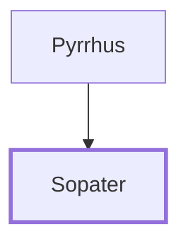

# Sopater

Companion of Paul from Berea, greeted the Roman church.

**Also called:** Sosipater

**Original-language names:** Σώπατρος (G4986) · Σωσίπατρος (G4989)

## When

- **Placed around:** [[connections/timeline/1st century AD|AD 60]] *(Ussher: the median date of the passages naming them)*

## Family

- **Father:** [[connections/people/Pyrrhus|Pyrrhus]]

**Family group:** [[connections/genealogy/Family of Pyrrhus|Family of Pyrrhus]], generation 2

## Events

- [[connections/timeline/1st century AD|AD 54]] · [[connections/events/Mission to Macedonia and Greece|Mission to Macedonia and Greece]]

## Appears in

[[connections/chapters/44-acts/Acts 20|Acts 20]] · [[connections/chapters/45-romans/Romans 16|Romans 16]]

## Appears in the same verse as

[[connections/people/Timothy|Timothy (2)]] · [[connections/people/Aristarchus|Aristarchus]] · [[connections/people/Gaius (Acts 20.4)|Gaius (Acts 20.4)]] · [[connections/people/Jason|Jason]] · [[connections/people/Lucius|Lucius]] · [[connections/people/Pyrrhus|Pyrrhus]] · [[connections/people/Secundus|Secundus]] · [[connections/people/Trophimus|Trophimus]] · [[connections/people/Tychicus|Tychicus]] · [[connections/places/Asia|Asia]] · [[connections/places/Derbe|Derbe]]
