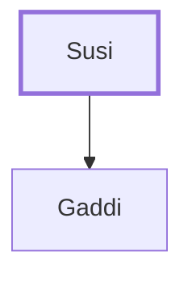

# Susi

Father of the Manassite spy Gaddi

**Original-language names:** סוּסִי (H5485)

## When

- **Placed around:** [[connections/timeline/15th century BC|1490 BC]] *(Ussher: the median date of the passages naming them)*

## Family

- **Children:** [[connections/people/Gaddi|Gaddi]]

**Family group:** [[connections/genealogy/Family of Susi|Family of Susi]], generation 1

## Appears in

[[connections/chapters/04-numbers/Numbers 13|Numbers 13]]

## Appears in the same verse as

[[connections/people/Gaddi|Gaddi]] · [[connections/people/Joseph (Genesis 30.24)|Joseph (Genesis 30.24)]] · [[connections/people/Manasseh (Genesis 41.51)|Manasseh (Genesis 41.51)]]
