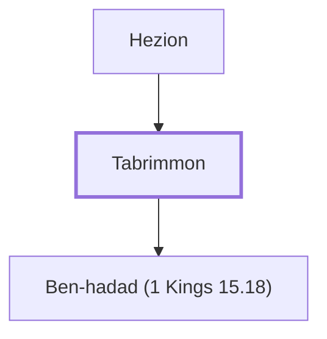

# Tabrimmon

Father of Ben-hadad I, king of Syria

**Original-language names:** טַבְרִמּוֹן (H2886)

## When

- **Placed around:** [[connections/timeline/10th century BC|930 BC]] *(Ussher: the median date of the passages naming them)*

## Family

- **Father:** [[connections/people/Hezion|Hezion]]
- **Children:** [[connections/people/Ben-hadad (1 Kings 15.18)|Ben-hadad (1 Kings 15.18)]]

**Family group:** [[connections/genealogy/Family of Hezion|Family of Hezion]], generation 2

## Appears in

[[connections/chapters/11-1-kings/1 Kings 15|1 Kings 15]]

## Appears in the same verse as

[[connections/people/Asa (1 Kings 15.8)|Asa (1 Kings 15.8)]] · [[connections/people/Ben-hadad (1 Kings 15.18)|Ben-hadad (1 Kings 15.18)]] · [[connections/people/Hezion|Hezion]] · [[connections/places/Damascus|Damascus]] · [[connections/places/Syria|Syria]]
