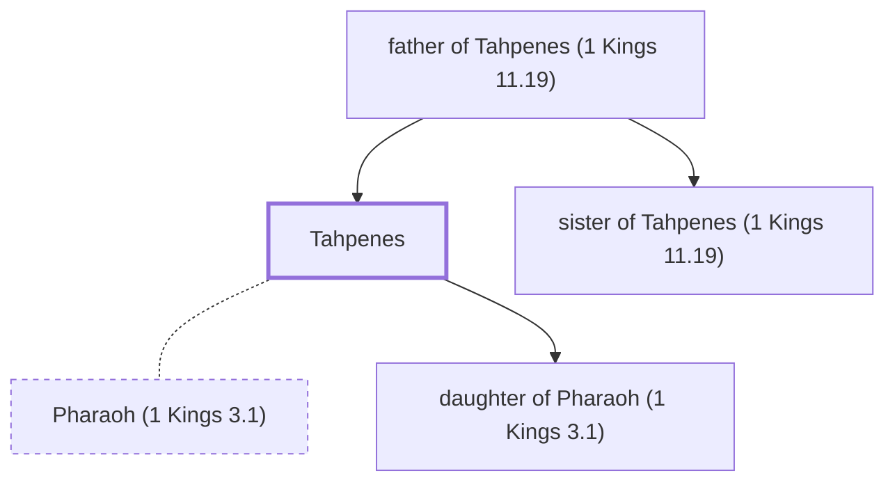

# Tahpenes

Egyptian queen who raised Hadad the Edomite

**Original-language names:** תַּחְפְּנֵיס (H8472)

## When

- **Placed around:** [[connections/timeline/10th century BC|984 BC]] *(Ussher: the median date of the passages naming them)*

## Family

- **Father:** [[connections/people/father of Tahpenes (1 Kings 11.19)|father of Tahpenes (1 Kings 11.19)]]
- **Brothers and sisters:** [[connections/people/sister of Tahpenes (1 Kings 11.19)|sister of Tahpenes (1 Kings 11.19)]]
- **Spouses:** [[connections/people/Pharaoh (1 Kings 3.1)|Pharaoh (1 Kings 3.1)]]
- **Children:** [[connections/people/daughter of Pharaoh (1 Kings 3.1)|daughter of Pharaoh (1 Kings 3.1)]]
- **Tribe or nation:** Egypt

**Family group:** [[connections/genealogy/Family of father of Tahpenes (1 Kings 11.19)|Family of father of Tahpenes (1 Kings 11.19)]], generation 2

## Appears in

[[connections/chapters/11-1-kings/1 Kings 11|1 Kings 11 (2)]]

## Appears in the same verse as

[[connections/people/Pharaoh (1 Kings 3.1)|Pharaoh (1 Kings 3.1) (2)]] · [[connections/people/Genubath|Genubath]] · [[connections/people/Hadad (1 Kings 11.14)|Hadad (1 Kings 11.14)]]
