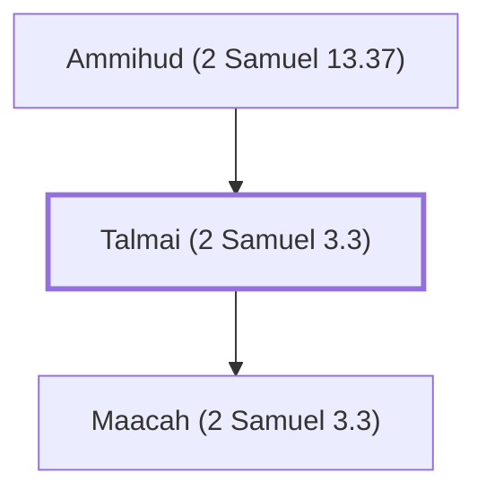

# Talmai (2 Samuel 3.3)

King of Geshur; father of David's wife Maacah

**Original-language names:** תַּלְמַי (H8526)

## When

- **Placed around:** [[connections/timeline/11th century BC|1048 BC]] *(Ussher: the median date of the passages naming them)*

## Family

- **Father:** [[connections/people/Ammihud (2 Samuel 13.37)|Ammihud (2 Samuel 13.37)]]
- **Children:** [[connections/people/Maacah (2 Samuel 3.3)|Maacah (2 Samuel 3.3)]]
- **Tribe or nation:** Ammon

**Family group:** [[connections/genealogy/Family of Adam|Family of Adam]], generation 2

## Appears in

[[connections/chapters/10-2-samuel/2 Samuel 3|2 Samuel 3]] · [[connections/chapters/10-2-samuel/2 Samuel 13|2 Samuel 13]] · [[connections/chapters/13-1-chronicles/1 Chronicles 3|1 Chronicles 3]]

## Appears in the same verse as

[[connections/people/Absalom|Absalom (3)]] · [[connections/places/Geshur|Geshur (3)]] · [[connections/people/Maacah (2 Samuel 3.3)|Maacah (2 Samuel 3.3) (2)]] · [[connections/people/Abigail (1 Samuel 25.3)|Abigail (1 Samuel 25.3)]] · [[connections/people/Adonijah (2 Samuel 3.4)|Adonijah (2 Samuel 3.4)]] · [[connections/people/Ammihud (2 Samuel 13.37)|Ammihud (2 Samuel 13.37)]] · [[connections/people/Chileab|Chileab]] · [[connections/people/Haggith|Haggith]] · [[connections/people/Nabal|Nabal]]
