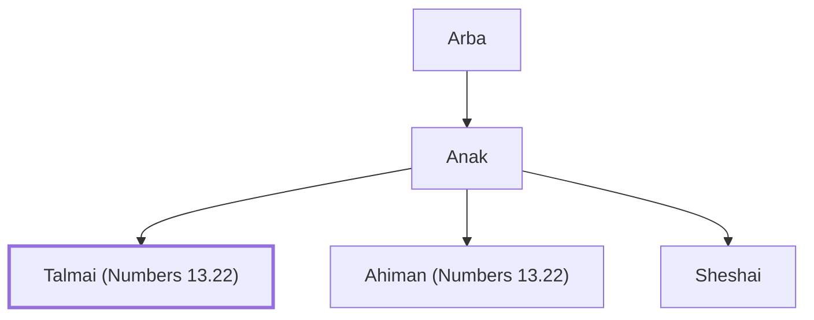

# Talmai (Numbers 13.22)

Anakim king of Hebron, defeated by Judah

**Original-language names:** תַּלְמַי (H8526)

## When

- **Placed around:** [[connections/timeline/15th century BC|1443 BC]] *(Ussher: the median date of the passages naming them)*

## Family

- **Father:** [[connections/people/Anak|Anak]]
- **Brothers and sisters:** [[connections/people/Ahiman (Numbers 13.22)|Ahiman (Numbers 13.22)]], [[connections/people/Sheshai|Sheshai]]

**Line of descent** (3 generations, father to son): [[connections/people/Arba|Arba]] → [[connections/people/Anak|Anak]] → **Talmai (Numbers 13.22)**

**Family group:** [[connections/genealogy/Family of Arba|Family of Arba]], generation 3

## Appears in

[[connections/chapters/04-numbers/Numbers 13|Numbers 13]] · [[connections/chapters/06-joshua/Joshua 15|Joshua 15]] · [[connections/chapters/07-judges/Judges 1|Judges 1]]

## Appears in the same verse as

[[connections/people/Ahiman (Numbers 13.22)|Ahiman (Numbers 13.22) (3)]] · [[connections/people/Sheshai|Sheshai (3)]] · [[connections/people/Anak|Anak (2)]] · [[connections/places/Hebron|Hebron (2)]] · [[connections/people/Caleb (Numbers 13.6)|Caleb (Numbers 13.6)]] · [[connections/people/Judah (Genesis 29.35)|Judah (Genesis 29.35)]] · [[connections/places/Egypt|Egypt]] · [[connections/places/Negeb|Negeb]] · [[connections/places/Zoan|Zoan]]
