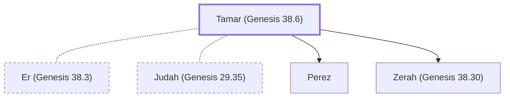

# Tamar (Genesis 38.6)

Judah's daughter-in-law who bore Perez and Zerah

**Original-language names:** תָּמָר (H8559) · Θάμαρ (G2283)

## When

- **Placed around:** [[connections/timeline/18th century BC|1722 BC]] *(Ussher: the median date of the passages naming them)*

## Family

- **Spouses:** [[connections/people/Er (Genesis 38.3)|Er (Genesis 38.3)]], [[connections/people/Judah (Genesis 29.35)|Judah (Genesis 29.35)]]
- **Children:** [[connections/people/Perez|Perez]], [[connections/people/Zerah (Genesis 38.30)|Zerah (Genesis 38.30)]]

**Family group:** [[connections/genealogy/Family of Adam|Family of Adam]], generation 26

## Events

- [[connections/timeline/18th century BC|1721 BC]] · [[connections/events/Birth of Perez|Birth of Perez]]

## Appears in

[[connections/chapters/01-genesis/Genesis 38|Genesis 38 (4)]] · [[connections/chapters/08-ruth/Ruth 4|Ruth 4]] · [[connections/chapters/13-1-chronicles/1 Chronicles 2|1 Chronicles 2]] · [[connections/chapters/40-matthew/Matthew 1|Matthew 1]]

## Appears in the same verse as

[[connections/people/Judah (Genesis 29.35)|Judah (Genesis 29.35) (6)]] · [[connections/people/Perez|Perez (3)]] · [[connections/people/Zerah (Genesis 38.30)|Zerah (Genesis 38.30) (2)]] · [[connections/people/Er (Genesis 38.3)|Er (Genesis 38.3)]] · [[connections/people/Hezron (Genesis 46.12)|Hezron (Genesis 46.12)]] · [[connections/people/Ram (Ruth 4.19)|Ram (Ruth 4.19)]] · [[connections/people/Shelah (Genesis 38.5)|Shelah (Genesis 38.5)]] · [[connections/places/Timnah (Genesis 38.12)|Timnah (Genesis 38.12)]]
