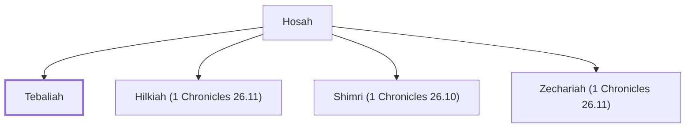

# Tebaliah

Levite gatekeeper, son of Hosah

**Original-language names:** טְבַלְיָ֫הוּ (H2882)

## When

- **Placed around:** [[connections/timeline/11th century BC|1015 BC]] *(Ussher: the median date of the passages naming them)*

## Family

- **Father:** [[connections/people/Hosah|Hosah]]
- **Brothers and sisters:** [[connections/people/Hilkiah (1 Chronicles 26.11)|Hilkiah (1 Chronicles 26.11)]], [[connections/people/Shimri (1 Chronicles 26.10)|Shimri (1 Chronicles 26.10)]], [[connections/people/Zechariah (1 Chronicles 26.11)|Zechariah (1 Chronicles 26.11)]]

**Family group:** [[connections/genealogy/Family of Hosah|Family of Hosah]], generation 2

## Appears in

[[connections/chapters/13-1-chronicles/1 Chronicles 26|1 Chronicles 26]]

## Appears in the same verse as

[[connections/people/Hilkiah (1 Chronicles 26.11)|Hilkiah (1 Chronicles 26.11)]] · [[connections/people/Hosah|Hosah]] · [[connections/people/Zechariah (1 Chronicles 26.11)|Zechariah (1 Chronicles 26.11)]]
