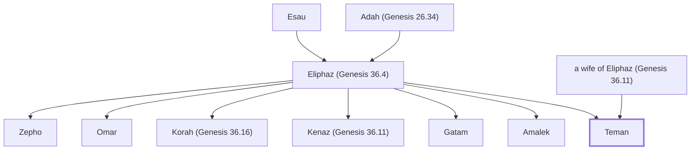

# Teman

Grandson of Esau, associated with an Edomite clan

**Original-language names:** תֵּימָן (H8487)

## When

- **Placed around:** [[connections/timeline/18th century BC|1734 BC]] *(Ussher: the median date of the passages naming them)*

## Family

- **Father:** [[connections/people/Eliphaz (Genesis 36.4)|Eliphaz (Genesis 36.4)]]
- **Mother:** [[connections/people/a wife of Eliphaz (Genesis 36.11)|a wife of Eliphaz (Genesis 36.11)]]
- **Brothers and sisters:** [[connections/people/Amalek|Amalek]], [[connections/people/Gatam|Gatam]], [[connections/people/Kenaz (Genesis 36.11)|Kenaz (Genesis 36.11)]], [[connections/people/Korah (Genesis 36.16)|Korah (Genesis 36.16)]], [[connections/people/Omar|Omar]], [[connections/people/Zepho|Zepho]]
- **Tribe or nation:** Edom

**Line of descent** (25 generations, father to son): [[connections/people/Adam|Adam]] → [[connections/people/Seth|Seth]] → [[connections/people/Enosh|Enosh]] → [[connections/people/Kenan|Kenan]] → [[connections/people/Mahalalel (Genesis 5.12)|Mahalalel (Genesis 5.12)]] → [[connections/people/Jared|Jared]] → [[connections/people/Enoch (Genesis 5.18)|Enoch (Genesis 5.18)]] → [[connections/people/Methuselah|Methuselah]] → [[connections/people/Lamech (Genesis 5.25)|Lamech (Genesis 5.25)]] → [[connections/people/Noah (Genesis 5.29)|Noah (Genesis 5.29)]] → [[connections/people/Shem|Shem]] → [[connections/people/Arpachshad|Arpachshad]] → [[connections/people/Cainan|Cainan]] → [[connections/people/Shelah (Genesis 10.24)|Shelah (Genesis 10.24)]] → [[connections/people/Eber (Genesis 10.21)|Eber (Genesis 10.21)]] → [[connections/people/Peleg|Peleg]] → [[connections/people/Reu|Reu]] → [[connections/people/Serug|Serug]] → [[connections/people/Nahor (Genesis 11.22)|Nahor (Genesis 11.22)]] → [[connections/people/Terah|Terah]] → [[connections/people/Abraham|Abraham]] → [[connections/people/Isaac|Isaac]] → [[connections/people/Esau|Esau]] → [[connections/people/Eliphaz (Genesis 36.4)|Eliphaz (Genesis 36.4)]] → **Teman**

**Family group:** [[connections/genealogy/Family of Adam|Family of Adam]], generation 25

## Appears in

[[connections/chapters/01-genesis/Genesis 36|Genesis 36 (3)]] · [[connections/chapters/13-1-chronicles/1 Chronicles 1|1 Chronicles 1 (2)]]

## Appears in the same verse as

[[connections/people/Kenaz (Genesis 36.11)|Kenaz (Genesis 36.11) (5)]] · [[connections/people/Eliphaz (Genesis 36.4)|Eliphaz (Genesis 36.4) (3)]] · [[connections/people/Omar|Omar (3)]] · [[connections/people/Zepho|Zepho (3)]] · [[connections/people/Gatam|Gatam (2)]] · [[connections/people/Mibzar|Mibzar (2)]] · [[connections/people/Esau|Esau]] · [[connections/people/Timna|Timna]] · [[connections/places/Amalek|Amalek]]
