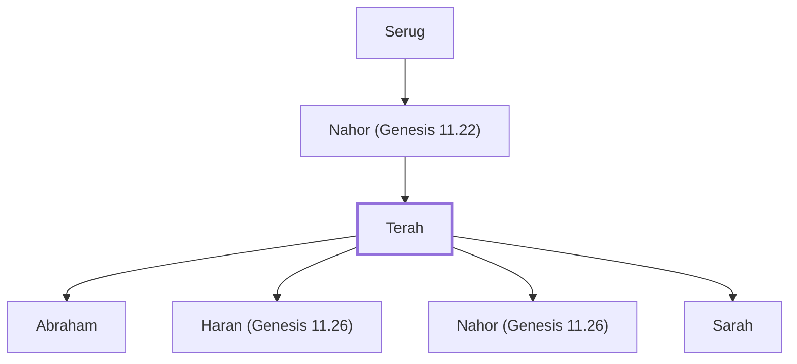

# Terah

Abraham's father who settled in Haran

**Original-language names:** תֶּ֫רַח (H8646) · Θάρα (G2291)

## When

- **Lived:** [[connections/timeline/22nd century BC|2126 BC]] – [[connections/timeline/20th century BC|1921 BC]] *(Jones)*
- **Placed around:** [[connections/timeline/20th century BC|1996 BC]] *(Ussher: the median date of the passages naming them)*

## Family

- **Father:** [[connections/people/Nahor (Genesis 11.22)|Nahor (Genesis 11.22)]]
- **Children:** [[connections/people/Abraham|Abraham]], [[connections/people/Haran (Genesis 11.26)|Haran (Genesis 11.26)]], [[connections/people/Nahor (Genesis 11.26)|Nahor (Genesis 11.26)]], [[connections/people/Sarah|Sarah]]
- **Tribe or nation:** Early Patriarch

**Line of descent** (20 generations, father to son): [[connections/people/Adam|Adam]] → [[connections/people/Seth|Seth]] → [[connections/people/Enosh|Enosh]] → [[connections/people/Kenan|Kenan]] → [[connections/people/Mahalalel (Genesis 5.12)|Mahalalel (Genesis 5.12)]] → [[connections/people/Jared|Jared]] → [[connections/people/Enoch (Genesis 5.18)|Enoch (Genesis 5.18)]] → [[connections/people/Methuselah|Methuselah]] → [[connections/people/Lamech (Genesis 5.25)|Lamech (Genesis 5.25)]] → [[connections/people/Noah (Genesis 5.29)|Noah (Genesis 5.29)]] → [[connections/people/Shem|Shem]] → [[connections/people/Arpachshad|Arpachshad]] → [[connections/people/Cainan|Cainan]] → [[connections/people/Shelah (Genesis 10.24)|Shelah (Genesis 10.24)]] → [[connections/people/Eber (Genesis 10.21)|Eber (Genesis 10.21)]] → [[connections/people/Peleg|Peleg]] → [[connections/people/Reu|Reu]] → [[connections/people/Serug|Serug]] → [[connections/people/Nahor (Genesis 11.22)|Nahor (Genesis 11.22)]] → **Terah**

**Family group:** [[connections/genealogy/Family of Adam|Family of Adam]], generation 20

## Events

- [[connections/timeline/22nd century BC|2126 BC]] · [[connections/events/Birth of Terah|Birth of Terah]]
- [[connections/timeline/22nd century BC|2126 BC]] · [[connections/events/Lifetime of Terah|Lifetime of Terah]]
- [[connections/timeline/20th century BC|1996 BC]] · [[connections/events/Birth of Abraham|Birth of Abraham]]
- [[connections/timeline/20th century BC|1921 BC]] · [[connections/events/Death of Terah|Death of Terah]]

## Appears in

[[connections/chapters/01-genesis/Genesis 11|Genesis 11 (7)]] · [[connections/chapters/06-joshua/Joshua 24|Joshua 24]] · [[connections/chapters/13-1-chronicles/1 Chronicles 1|1 Chronicles 1]] · [[connections/chapters/42-luke/Luke 3|Luke 3]]

## Appears in the same verse as

[[connections/people/Abraham|Abraham (5)]] · [[connections/people/Nahor (Genesis 11.22)|Nahor (Genesis 11.22) (5)]] · [[connections/people/Haran (Genesis 11.26)|Haran (Genesis 11.26) (4)]] · [[connections/people/Israel|Israel (2)]] · [[connections/people/Lot|Lot (2)]] · [[connections/people/Nahor (Genesis 11.26)|Nahor (Genesis 11.26) (2)]] · [[connections/places/Chaldea|Chaldea (2)]] · [[connections/places/Haran|Haran (2)]] · [[connections/places/Ur|Ur (2)]] · [[connections/people/Isaac|Isaac]] · [[connections/people/Joshua (Exodus 17.9)|Joshua (Exodus 17.9)]] · [[connections/people/Sarah|Sarah]] · [[connections/people/Serug|Serug]] · [[connections/places/Canaan|Canaan]] · [[connections/places/Euphrates|Euphrates]]
