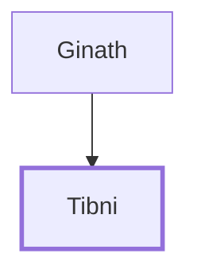

# Tibni

Rival to Omri for the throne of Israel

**Original-language names:** תִּבְנִי (H8402)

## When

- **Placed around:** [[connections/timeline/10th century BC|929 BC]] *(Ussher: the median date of the passages naming them)*

## Family

- **Father:** [[connections/people/Ginath|Ginath]]

**Family group:** [[connections/genealogy/Family of Ginath|Family of Ginath]], generation 2

## Events

- [[connections/timeline/10th century BC|929 BC]] · [[connections/events/Reign of Tibni|Reign of Tibni]]
- [[connections/timeline/10th century BC|925 BC]] · [[connections/events/Death of Tibni|Death of Tibni]]

## Appears in

[[connections/chapters/11-1-kings/1 Kings 16|1 Kings 16 (2)]]

## Appears in the same verse as

[[connections/people/Ginath|Ginath (2)]] · [[connections/people/Omri (1 Kings 16.16)|Omri (1 Kings 16.16) (2)]] · [[connections/people/Israel|Israel]]
