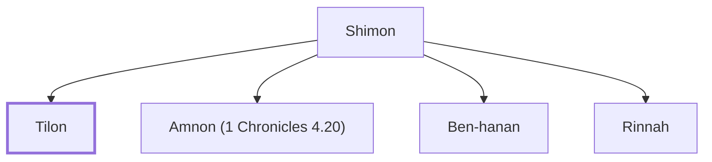

# Tilon

Son of Shimon from the tribe of Judah

**Original-language names:** תִּילוֹן (H8436)

## When

- **Placed around:** [[connections/timeline/18th century BC|1721 BC]] *(Ussher: the median date of the passages naming them)*

## Family

- **Father:** [[connections/people/Shimon|Shimon]]
- **Brothers and sisters:** [[connections/people/Amnon (1 Chronicles 4.20)|Amnon (1 Chronicles 4.20)]], [[connections/people/Ben-hanan|Ben-hanan]], [[connections/people/Rinnah|Rinnah]]
- **Tribe or nation:** Tribe of Judah(?)

**Family group:** [[connections/genealogy/Family of Shimon|Family of Shimon]], generation 2

## Appears in

[[connections/chapters/13-1-chronicles/1 Chronicles 4|1 Chronicles 4]]

## Appears in the same verse as

[[connections/people/Amnon (1 Chronicles 4.20)|Amnon (1 Chronicles 4.20)]] · [[connections/people/Ben-hanan|Ben-hanan]] · [[connections/people/Ben-zoheth|Ben-zoheth]] · [[connections/people/Ishi (1 Chronicles 4.20)|Ishi (1 Chronicles 4.20)]] · [[connections/people/Rinnah|Rinnah]] · [[connections/people/Shimon|Shimon]] · [[connections/people/Zoheth|Zoheth]]
