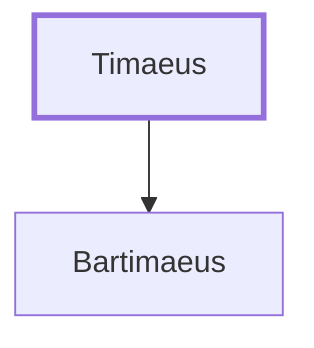

# Timaeus

Father of Bartimaeus, a blind man healed by Jesus

**Original-language names:** Τιμαῖος (G5090)

## When

- **Placed around:** [[connections/timeline/1st century AD|AD 29]] *(Ussher: the median date of the passages naming them)*

## Family

- **Children:** [[connections/people/Bartimaeus|Bartimaeus]]

**Family group:** [[connections/genealogy/Family of Timaeus|Family of Timaeus]], generation 1

## Appears in

[[connections/chapters/41-mark/Mark 10|Mark 10]]

## Appears in the same verse as

[[connections/people/Bartimaeus|Bartimaeus]] · [[connections/places/Jericho|Jericho]]
