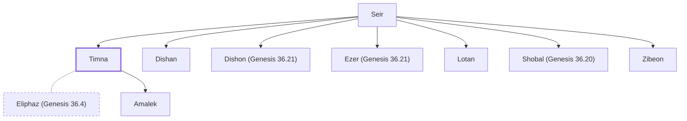

# Timna

Concubine of Eliphaz; mother of Amalek

**Original-language names:** תִּמְנָע (H8555)

## When

- **Placed around:** [[connections/timeline/18th century BC|1756 BC]] *(Ussher: the median date of the passages naming them)*

## Family

- **Father:** [[connections/people/Seir|Seir]]
- **Brothers and sisters:** [[connections/people/Dishan|Dishan]], [[connections/people/Dishon (Genesis 36.21)|Dishon (Genesis 36.21)]], [[connections/people/Ezer (Genesis 36.21)|Ezer (Genesis 36.21)]], [[connections/people/Lotan|Lotan]], [[connections/people/Shobal (Genesis 36.20)|Shobal (Genesis 36.20)]], [[connections/people/Zibeon|Zibeon]]
- **Spouses:** [[connections/people/Eliphaz (Genesis 36.4)|Eliphaz (Genesis 36.4)]]
- **Children:** [[connections/people/Amalek|Amalek]]
- **Tribe or nation:** Edom

**Family group:** [[connections/genealogy/Family of Adam|Family of Adam]], generation 2

## Appears in

[[connections/chapters/01-genesis/Genesis 36|Genesis 36 (3)]] · [[connections/chapters/13-1-chronicles/1 Chronicles 1|1 Chronicles 1 (3)]]

## Appears in the same verse as

[[connections/people/Alvah|Alvah (2)]] · [[connections/people/Eliphaz (Genesis 36.4)|Eliphaz (Genesis 36.4) (2)]] · [[connections/people/Esau|Esau (2)]] · [[connections/people/Hemam|Hemam (2)]] · [[connections/people/Hori (Genesis 36.22)|Hori (Genesis 36.22) (2)]] · [[connections/people/Jetheth|Jetheth (2)]] · [[connections/people/Lotan|Lotan (2)]] · [[connections/people/Adah (Genesis 26.34)|Adah (Genesis 26.34)]] · [[connections/people/Amalek|Amalek]] · [[connections/people/Gatam|Gatam]] · [[connections/people/Hadad (Genesis 36.39)|Hadad (Genesis 36.39)]] · [[connections/people/Kenaz (Genesis 36.11)|Kenaz (Genesis 36.11)]] · [[connections/people/Omar|Omar]] · [[connections/people/Teman|Teman]] · [[connections/people/Zepho|Zepho]] · [[connections/places/Amalek|Amalek]]
