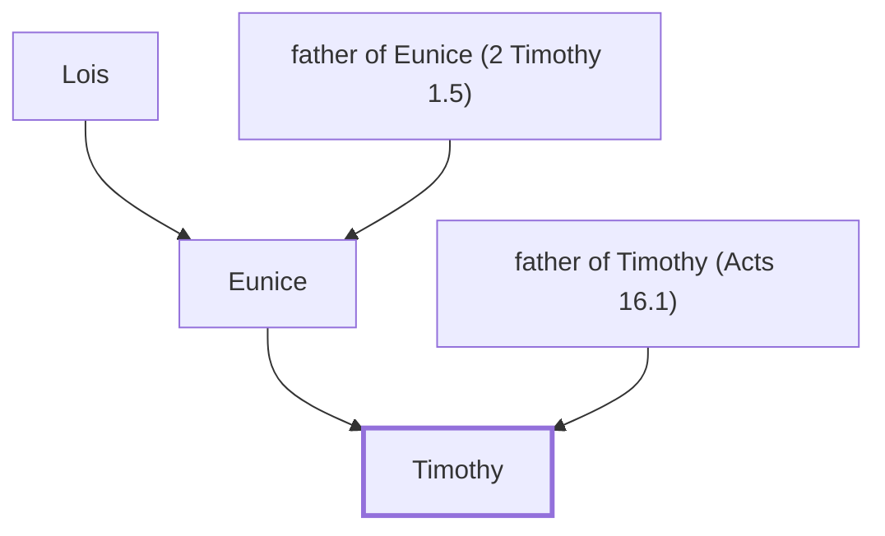

# Timothy

Paul's young disciple and co-worker

**Original-language names:** Τιμόθεος (G5095)

## When

- **Placed around:** [[connections/timeline/1st century AD|AD 60]] *(Ussher: the median date of the passages naming them)*

## Family

- **Father:** [[connections/people/father of Timothy (Acts 16.1)|father of Timothy (Acts 16.1)]]
- **Mother:** [[connections/people/Eunice|Eunice]]

**Family group:** [[connections/genealogy/Family of Lois|Family of Lois]], generation 3

## Events

- [[connections/timeline/1st century AD|AD 46]] · [[connections/events/Second Missionary Journey|Second Missionary Journey]]
- [[connections/timeline/1st century AD|AD 47]] · [[connections/events/Timothy Joins Paul and Silas|Timothy Joins Paul and Silas]]
- [[connections/timeline/1st century AD|AD 47]] · [[connections/events/Mission to Phrygia, Galatia and Asia|Mission to Phrygia, Galatia and Asia]]
- [[connections/timeline/1st century AD|AD 47]] · [[connections/events/Call to Macedonia|Call to Macedonia]]
- [[connections/timeline/1st century AD|AD 47]] · [[connections/events/Lydia's Conversion|Lydia's Conversion]]
- [[connections/timeline/1st century AD|AD 47]] · [[connections/events/Paul casts demon out of soothsayer|Paul casts demon out of soothsayer]]
- [[connections/timeline/1st century AD|AD 48]] · [[connections/events/Mission to Berea|Mission to Berea]]
- [[connections/timeline/1st century AD|AD 49]] · [[connections/events/Mission to Corinth, 1&2 Thess Written|Mission to Corinth, 1&2 Thess Written]]
- [[connections/timeline/1st century AD|AD 50]] · [[connections/events/Third Missionary Journey|Third Missionary Journey]]
- [[connections/timeline/1st century AD|AD 53]] · [[connections/events/Mission to Ephesus-1 Cor Written|Mission to Ephesus/1 Cor Written]]
- [[connections/timeline/1st century AD|AD 54]] · [[connections/events/Mission to Macedonia and Greece|Mission to Macedonia and Greece]]

## Appears in

[[connections/chapters/44-acts/Acts 16|Acts 16]] · [[connections/chapters/44-acts/Acts 17|Acts 17 (2)]] · [[connections/chapters/44-acts/Acts 18|Acts 18]] · [[connections/chapters/44-acts/Acts 19|Acts 19]] · [[connections/chapters/44-acts/Acts 20|Acts 20]] · [[connections/chapters/45-romans/Romans 16|Romans 16]] · [[connections/chapters/46-1-corinthians/1 Corinthians 4|1 Corinthians 4]] · [[connections/chapters/46-1-corinthians/1 Corinthians 16|1 Corinthians 16 (2)]] · [[connections/chapters/47-2-corinthians/2 Corinthians 1|2 Corinthians 1 (2)]] · [[connections/chapters/50-philippians/Philippians 1|Philippians 1]] · [[connections/chapters/50-philippians/Philippians 2|Philippians 2]] · [[connections/chapters/51-colossians/Colossians 1|Colossians 1]] · [[connections/chapters/52-1-thessalonians/1 Thessalonians 1|1 Thessalonians 1]] · [[connections/chapters/52-1-thessalonians/1 Thessalonians 3|1 Thessalonians 3 (2)]] · [[connections/chapters/53-2-thessalonians/2 Thessalonians 1|2 Thessalonians 1]] · [[connections/chapters/54-1-timothy/1 Timothy 1|1 Timothy 1 (2)]] · [[connections/chapters/54-1-timothy/1 Timothy 6|1 Timothy 6 (2)]] · [[connections/chapters/55-2-timothy/2 Timothy 1|2 Timothy 1]] · [[connections/chapters/55-2-timothy/2 Timothy 4|2 Timothy 4]] · [[connections/chapters/57-philemon/Philemon 1|Philemon 1]] · [[connections/chapters/58-hebrews/Hebrews 13|Hebrews 13 (2)]]

## Appears in the same verse as

[[connections/people/Jesus|Jesus (14)]] · [[connections/people/Paul|Paul (10)]] · [[connections/people/Silas|Silas (6)]] · [[connections/people/Sopater|Sopater (2)]] · [[connections/places/Asia|Asia (2)]] · [[connections/places/Corinth|Corinth (2)]] · [[connections/places/Derbe|Derbe (2)]] · [[connections/places/Macedonia|Macedonia (2)]] · [[connections/places/Philippi|Philippi (2)]] · [[connections/people/Achaicus|Achaicus]] · [[connections/people/Aristarchus|Aristarchus]] · [[connections/people/Erastus|Erastus]] · [[connections/people/Fortunatus|Fortunatus]] · [[connections/people/Gaius (Acts 20.4)|Gaius (Acts 20.4)]] · [[connections/people/Hebrews|Hebrews]] · [[connections/people/Jason|Jason]] · [[connections/people/Javan|Javan]] · [[connections/people/Lucius|Lucius]] · [[connections/people/Nero|Nero]] · [[connections/people/Philemon|Philemon]] · [[connections/people/Pyrrhus|Pyrrhus]] · [[connections/people/Secundus|Secundus]] · [[connections/people/Stephanas|Stephanas]] · [[connections/people/Trophimus|Trophimus]] · [[connections/people/Tychicus|Tychicus]] · [[connections/places/Achaia|Achaia]] · [[connections/places/Athens|Athens]] · [[connections/places/Ephesus|Ephesus]] · [[connections/places/Italy|Italy]] · [[connections/places/Laodicea|Laodicea]] · [[connections/places/Lystra|Lystra]] · [[connections/places/Pacatiana|Pacatiana]] · [[connections/places/Phrygia|Phrygia]] · [[connections/places/Rome|Rome]]
