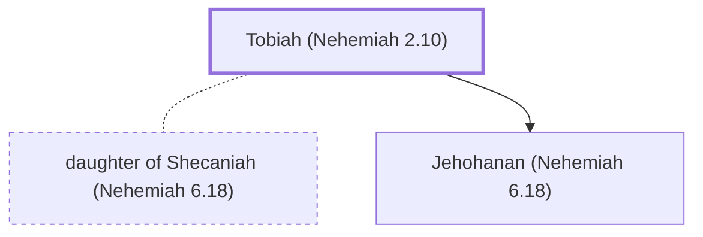

# Tobiah (Nehemiah 2.10)

Ammonite official who opposed Nehemiah's rebuilding efforts

**Original-language names:** טוֹבִיָּ֫הוּ (H2900)

## When

- **Placed around:** [[connections/timeline/5th century BC|445 BC]] *(Ussher: the median date of the passages naming them)*

## Family

- **Spouses:** [[connections/people/daughter of Shecaniah (Nehemiah 6.18)|daughter of Shecaniah (Nehemiah 6.18)]]
- **Children:** [[connections/people/Jehohanan (Nehemiah 6.18)|Jehohanan (Nehemiah 6.18)]]
- **Tribe or nation:** Ammon

**Family group:** [[connections/genealogy/Family of Arah (Nehemiah 6.18)|Family of Arah (Nehemiah 6.18)]], generation 3

## Appears in

[[connections/chapters/16-nehemiah/Nehemiah 2|Nehemiah 2 (2)]] · [[connections/chapters/16-nehemiah/Nehemiah 3|Nehemiah 3]] · [[connections/chapters/16-nehemiah/Nehemiah 4|Nehemiah 4]] · [[connections/chapters/16-nehemiah/Nehemiah 6|Nehemiah 6 (5)]] · [[connections/chapters/16-nehemiah/Nehemiah 13|Nehemiah 13 (3)]]

## Appears in the same verse as

[[connections/people/Sanballat|Sanballat (6)]] · [[connections/people/Eliashib (Nehemiah 13.4)|Eliashib (Nehemiah 13.4) (2)]] · [[connections/people/Geshem|Geshem (2)]] · [[connections/places/Jerusalem|Jerusalem (2)]] · [[connections/people/Israel|Israel]] · [[connections/people/Judah (Genesis 29.35)|Judah (Genesis 29.35)]] · [[connections/people/Noadiah (Nehemiah 6.14)|Noadiah (Nehemiah 6.14)]]
