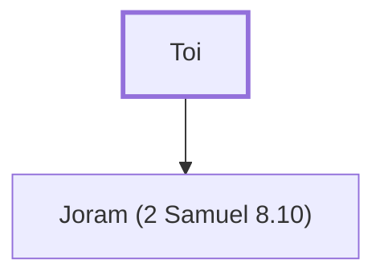

# Toi

King of Hamath who sent his son to David

**Also called:** Tou

**Original-language names:** תֹּ֫עִי (H8583) · תֹּעוּ (H8583)

## When

- **Placed around:** [[connections/timeline/11th century BC|1040 BC]] *(Ussher: the median date of the passages naming them)*

## Family

- **Children:** [[connections/people/Joram (2 Samuel 8.10)|Joram (2 Samuel 8.10)]]
- **Tribe or nation:** Syria

**Family group:** [[connections/genealogy/Family of Toi|Family of Toi]], generation 1

## Appears in

[[connections/chapters/10-2-samuel/2 Samuel 8|2 Samuel 8 (2)]] · [[connections/chapters/13-1-chronicles/1 Chronicles 18|1 Chronicles 18 (2)]]

## Appears in the same verse as

[[connections/people/David|David (4)]] · [[connections/people/Hadadezer|Hadadezer (4)]] · [[connections/people/Joram (2 Samuel 8.10)|Joram (2 Samuel 8.10) (2)]] · [[connections/places/Hamath|Hamath (2)]] · [[connections/places/Zobah|Zobah]]
