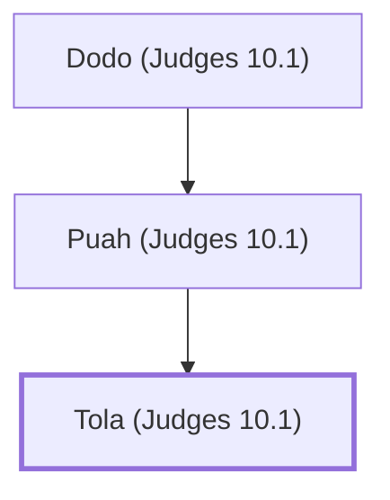

# Tola (Judges 10.1)

Judge of Israel who succeeded Abimelech

**Original-language names:** תּוֹלָע (H8439)

## When

- **Placed around:** [[connections/timeline/13th century BC|1232 BC]] *(Ussher: the median date of the passages naming them)*

## Family

- **Father:** [[connections/people/Puah (Judges 10.1)|Puah (Judges 10.1)]]

**Line of descent** (3 generations, father to son): [[connections/people/Dodo (Judges 10.1)|Dodo (Judges 10.1)]] → [[connections/people/Puah (Judges 10.1)|Puah (Judges 10.1)]] → **Tola (Judges 10.1)**

**Family group:** [[connections/genealogy/Family of Dodo (Judges 10.1)|Family of Dodo (Judges 10.1)]], generation 3

## Events

- [[connections/timeline/13th century BC|1215 BC]] · [[connections/events/Judgeship of Tola|Judgeship of Tola]]

## Appears in

[[connections/chapters/07-judges/Judges 10|Judges 10]]

## Appears in the same verse as

[[connections/people/Abimelech (Judges 8.31)|Abimelech (Judges 8.31)]] · [[connections/people/Dodo (Judges 10.1)|Dodo (Judges 10.1)]] · [[connections/people/Ephraim|Ephraim]] · [[connections/people/Israel|Israel]] · [[connections/people/Issachar (Genesis 30.18)|Issachar (Genesis 30.18)]] · [[connections/people/Puah (Judges 10.1)|Puah (Judges 10.1)]] · [[connections/places/Shamir (Judges 10.1)|Shamir (Judges 10.1)]]
