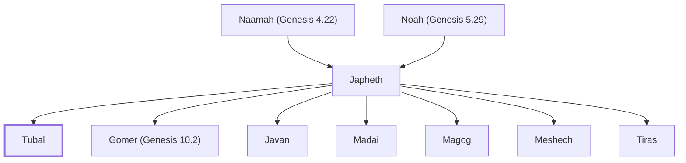

# Tubal

Son of Japheth, grandson of Noah

**Original-language names:** תּוּבַל (H8422)

## Family

- **Father:** [[connections/people/Japheth|Japheth]]
- **Brothers and sisters:** [[connections/people/Gomer (Genesis 10.2)|Gomer (Genesis 10.2)]], [[connections/people/Javan|Javan]], [[connections/people/Madai|Madai]], [[connections/people/Magog|Magog]], [[connections/people/Meshech|Meshech]], [[connections/people/Tiras|Tiras]]
- **Tribe or nation:** Early Patriarch

**Line of descent** (12 generations, father to son): [[connections/people/Adam|Adam]] → [[connections/people/Seth|Seth]] → [[connections/people/Enosh|Enosh]] → [[connections/people/Kenan|Kenan]] → [[connections/people/Mahalalel (Genesis 5.12)|Mahalalel (Genesis 5.12)]] → [[connections/people/Jared|Jared]] → [[connections/people/Enoch (Genesis 5.18)|Enoch (Genesis 5.18)]] → [[connections/people/Methuselah|Methuselah]] → [[connections/people/Lamech (Genesis 5.25)|Lamech (Genesis 5.25)]] → [[connections/people/Noah (Genesis 5.29)|Noah (Genesis 5.29)]] → [[connections/people/Japheth|Japheth]] → **Tubal**

**Family group:** [[connections/genealogy/Family of Adam|Family of Adam]], generation 12

## Appears in

[[connections/chapters/01-genesis/Genesis 10|Genesis 10]] · [[connections/chapters/13-1-chronicles/1 Chronicles 1|1 Chronicles 1]]

## Appears in the same verse as

[[connections/people/Gomer (Genesis 10.2)|Gomer (Genesis 10.2) (2)]] · [[connections/people/Japheth|Japheth (2)]] · [[connections/people/Javan|Javan (2)]] · [[connections/people/Madai|Madai (2)]] · [[connections/people/Magog|Magog (2)]] · [[connections/people/Meshech|Meshech (2)]] · [[connections/people/Tiras|Tiras (2)]]
