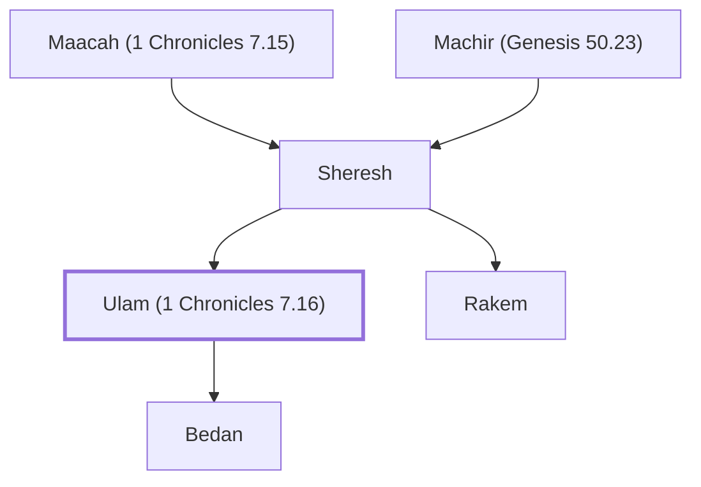

# Ulam (1 Chronicles 7.16)

Son of Sheresh, great-grandson of Manasseh

**Original-language names:** אוּלָם (H0198)

## Family

- **Father:** [[connections/people/Sheresh|Sheresh]]
- **Brothers and sisters:** [[connections/people/Rakem|Rakem]]
- **Children:** [[connections/people/Bedan|Bedan]]
- **Tribe or nation:** Tribe of Manasseh

**Line of descent** (28 generations, father to son): [[connections/people/Adam|Adam]] → [[connections/people/Seth|Seth]] → [[connections/people/Enosh|Enosh]] → [[connections/people/Kenan|Kenan]] → [[connections/people/Mahalalel (Genesis 5.12)|Mahalalel (Genesis 5.12)]] → [[connections/people/Jared|Jared]] → [[connections/people/Enoch (Genesis 5.18)|Enoch (Genesis 5.18)]] → [[connections/people/Methuselah|Methuselah]] → [[connections/people/Lamech (Genesis 5.25)|Lamech (Genesis 5.25)]] → [[connections/people/Noah (Genesis 5.29)|Noah (Genesis 5.29)]] → [[connections/people/Shem|Shem]] → [[connections/people/Arpachshad|Arpachshad]] → [[connections/people/Cainan|Cainan]] → [[connections/people/Shelah (Genesis 10.24)|Shelah (Genesis 10.24)]] → [[connections/people/Eber (Genesis 10.21)|Eber (Genesis 10.21)]] → [[connections/people/Peleg|Peleg]] → [[connections/people/Reu|Reu]] → [[connections/people/Serug|Serug]] → [[connections/people/Nahor (Genesis 11.22)|Nahor (Genesis 11.22)]] → [[connections/people/Terah|Terah]] → [[connections/people/Abraham|Abraham]] → [[connections/people/Isaac|Isaac]] → [[connections/people/Israel|Israel]] → [[connections/people/Joseph (Genesis 30.24)|Joseph (Genesis 30.24)]] → [[connections/people/Manasseh (Genesis 41.51)|Manasseh (Genesis 41.51)]] → [[connections/people/Machir (Genesis 50.23)|Machir (Genesis 50.23)]] → [[connections/people/Sheresh|Sheresh]] → **Ulam (1 Chronicles 7.16)**

**Family group:** [[connections/genealogy/Family of Adam|Family of Adam]], generation 28

## Appears in

[[connections/chapters/13-1-chronicles/1 Chronicles 7|1 Chronicles 7 (2)]]

## Appears in the same verse as

[[connections/people/Machir (Genesis 50.23)|Machir (Genesis 50.23) (2)]] · [[connections/people/Bedan|Bedan]] · [[connections/people/Gilead (Numbers 26.29)|Gilead (Numbers 26.29)]] · [[connections/people/Maacah (1 Chronicles 7.15)|Maacah (1 Chronicles 7.15)]] · [[connections/people/Manasseh (Genesis 41.51)|Manasseh (Genesis 41.51)]] · [[connections/people/Peresh|Peresh]] · [[connections/people/Rakem|Rakem]] · [[connections/people/Sheresh|Sheresh]]
