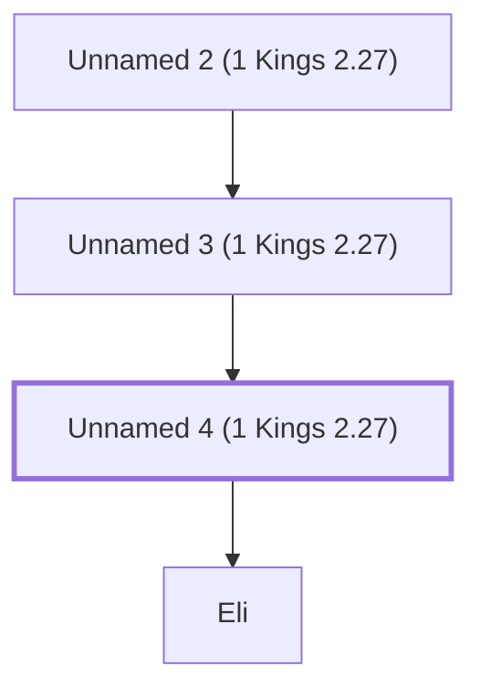

# Unnamed 4 (1 Kings 2.27)

A descendant of Ithamar the son of Aaron.

*Not named in the text. Included because a family line passes through this person.*

## Family

- **Father:** [[connections/people/Unnamed 3 (1 Kings 2.27)|Unnamed 3 (1 Kings 2.27)]]
- **Children:** [[connections/people/Eli|Eli]]
- **Tribe or nation:** Tribe of Levi

**Line of descent** (32 generations, father to son): [[connections/people/Adam|Adam]] → [[connections/people/Seth|Seth]] → [[connections/people/Enosh|Enosh]] → [[connections/people/Kenan|Kenan]] → [[connections/people/Mahalalel (Genesis 5.12)|Mahalalel (Genesis 5.12)]] → [[connections/people/Jared|Jared]] → [[connections/people/Enoch (Genesis 5.18)|Enoch (Genesis 5.18)]] → [[connections/people/Methuselah|Methuselah]] → [[connections/people/Lamech (Genesis 5.25)|Lamech (Genesis 5.25)]] → [[connections/people/Noah (Genesis 5.29)|Noah (Genesis 5.29)]] → [[connections/people/Shem|Shem]] → [[connections/people/Arpachshad|Arpachshad]] → [[connections/people/Cainan|Cainan]] → [[connections/people/Shelah (Genesis 10.24)|Shelah (Genesis 10.24)]] → [[connections/people/Eber (Genesis 10.21)|Eber (Genesis 10.21)]] → [[connections/people/Peleg|Peleg]] → [[connections/people/Reu|Reu]] → [[connections/people/Serug|Serug]] → [[connections/people/Nahor (Genesis 11.22)|Nahor (Genesis 11.22)]] → [[connections/people/Terah|Terah]] → [[connections/people/Abraham|Abraham]] → [[connections/people/Isaac|Isaac]] → [[connections/people/Israel|Israel]] → [[connections/people/Levi (Genesis 29.34)|Levi (Genesis 29.34)]] → [[connections/people/Kohath|Kohath]] → [[connections/people/Amram (Exodus 6.18)|Amram (Exodus 6.18)]] → [[connections/people/Aaron|Aaron]] → [[connections/people/Ithamar|Ithamar]] → [[connections/people/Unnamed 1 (1 Kings 2.27)|Unnamed 1 (1 Kings 2.27)]] → [[connections/people/Unnamed 2 (1 Kings 2.27)|Unnamed 2 (1 Kings 2.27)]] → [[connections/people/Unnamed 3 (1 Kings 2.27)|Unnamed 3 (1 Kings 2.27)]] → **Unnamed 4 (1 Kings 2.27)**

**Family group:** [[connections/genealogy/Family of Adam|Family of Adam]], generation 32

## Mentioned in

[[connections/chapters/11-1-kings/1 Kings 2|1 Kings 2]]
