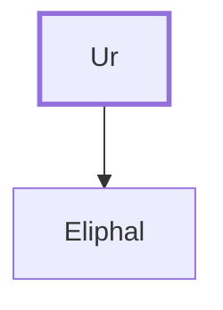

# Ur

Father of one of David's mighty men

**Original-language names:** אוּר (H0218a)

## When

- **Placed around:** [[connections/timeline/11th century BC|1055 BC]] *(Ussher: the median date of the passages naming them)*

## Family

- **Children:** [[connections/people/Eliphal|Eliphal]]

**Family group:** [[connections/genealogy/Family of Ur|Family of Ur]], generation 1

## Appears in

[[connections/chapters/13-1-chronicles/1 Chronicles 11|1 Chronicles 11]]

## Appears in the same verse as

[[connections/people/Ahiam|Ahiam]] · [[connections/people/Eliphal|Eliphal]] · [[connections/people/Sharar|Sharar]]
