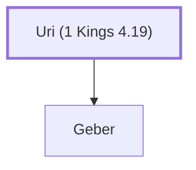

# Uri (1 Kings 4.19)

Father of Geber, one of Solomon's officers

**Original-language names:** אוּרִי (H0221)

## When

- **Placed around:** [[connections/timeline/11th century BC|1014 BC]] *(Ussher: the median date of the passages naming them)*

## Family

- **Children:** [[connections/people/Geber|Geber]]

**Family group:** [[connections/genealogy/Family of Uri (1 Kings 4.19)|Family of Uri (1 Kings 4.19)]], generation 1

## Appears in

[[connections/chapters/11-1-kings/1 Kings 4|1 Kings 4]]

## Appears in the same verse as

[[connections/people/Geber|Geber]] · [[connections/people/Og|Og]] · [[connections/people/Sihon|Sihon]] · [[connections/places/Bashan|Bashan]] · [[connections/places/Gilead|Gilead]]
