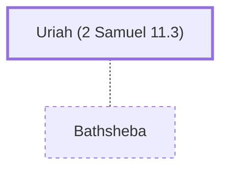

# Uriah (2 Samuel 11.3)

Hittite soldier; husband of Bathsheba

**Original-language names:** אוּרִיָּה (H0223a) · Οὐρίας (G3774)

## When

- **Placed around:** [[connections/timeline/11th century BC|1035 BC]] *(Ussher: the median date of the passages naming them)*

## Family

- **Spouses:** [[connections/people/Bathsheba|Bathsheba]]

## Appears in

[[connections/chapters/10-2-samuel/2 Samuel 11|2 Samuel 11 (15)]] · [[connections/chapters/10-2-samuel/2 Samuel 12|2 Samuel 12 (3)]] · [[connections/chapters/10-2-samuel/2 Samuel 23|2 Samuel 23]] · [[connections/chapters/11-1-kings/1 Kings 15|1 Kings 15]] · [[connections/chapters/13-1-chronicles/1 Chronicles 11|1 Chronicles 11]] · [[connections/chapters/40-matthew/Matthew 1|Matthew 1]]

## Appears in the same verse as

[[connections/people/David|David (12)]] · [[connections/people/Joab (1 Samuel 26.6)|Joab (1 Samuel 26.6) (6)]] · [[connections/people/Abimelech (Judges 8.31)|Abimelech (Judges 8.31)]] · [[connections/people/Ahlai (1 Chronicles 11.41)|Ahlai (1 Chronicles 11.41)]] · [[connections/people/Bathsheba|Bathsheba]] · [[connections/people/Eliam (2 Samuel 11.3)|Eliam (2 Samuel 11.3)]] · [[connections/people/Gideon|Gideon]] · [[connections/people/Israel|Israel]] · [[connections/people/Jesse|Jesse]] · [[connections/people/Judah (Genesis 29.35)|Judah (Genesis 29.35)]] · [[connections/people/Nathan (2 Samuel 7.2)|Nathan (2 Samuel 7.2)]] · [[connections/people/Solomon|Solomon]] · [[connections/people/Zabad (1 Chronicles 11.41)|Zabad (1 Chronicles 11.41)]] · [[connections/places/Ammon|Ammon]] · [[connections/places/Jerusalem|Jerusalem]] · [[connections/places/Thebez|Thebez]]
