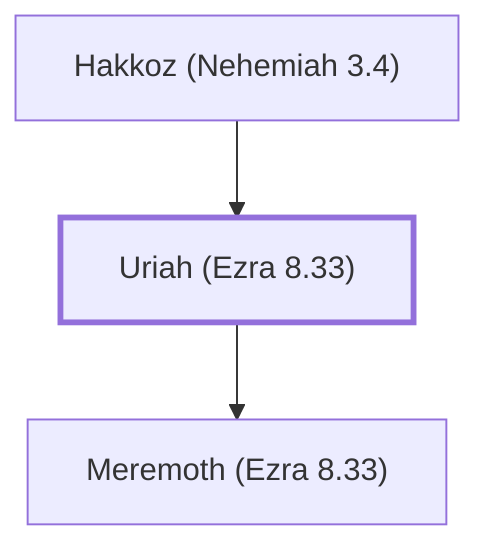

# Uriah (Ezra 8.33)

Postexilic priest involved in rebuilding the wall

**Original-language names:** אוּרִיָּה (H0223a)

## When

- **Placed around:** [[connections/timeline/5th century BC|445 BC]] *(Ussher: the median date of the passages naming them)*

## Family

- **Father:** [[connections/people/Hakkoz (Nehemiah 3.4)|Hakkoz (Nehemiah 3.4)]]
- **Children:** [[connections/people/Meremoth (Ezra 8.33)|Meremoth (Ezra 8.33)]]

**Family group:** [[connections/genealogy/Family of Hakkoz (Nehemiah 3.4)|Family of Hakkoz (Nehemiah 3.4)]], generation 2

## Appears in

[[connections/chapters/15-ezra/Ezra 8|Ezra 8]] · [[connections/chapters/16-nehemiah/Nehemiah 3|Nehemiah 3 (2)]]

## Appears in the same verse as

[[connections/people/Meremoth (Ezra 8.33)|Meremoth (Ezra 8.33) (3)]] · [[connections/people/Hakkoz (Nehemiah 3.4)|Hakkoz (Nehemiah 3.4) (2)]] · [[connections/people/Baana (Nehemiah 3.4)|Baana (Nehemiah 3.4)]] · [[connections/people/Berechiah (Nehemiah 3.4)|Berechiah (Nehemiah 3.4)]] · [[connections/people/Binnui (Ezra 8.33)|Binnui (Ezra 8.33)]] · [[connections/people/Eleazar (Ezra 8.33)|Eleazar (Ezra 8.33)]] · [[connections/people/Eliashib (Nehemiah 3.1)|Eliashib (Nehemiah 3.1)]] · [[connections/people/Jeshua (Ezra 8.33)|Jeshua (Ezra 8.33)]] · [[connections/people/Jozabad (Ezra 8.33)|Jozabad (Ezra 8.33)]] · [[connections/people/Meshezabel (Nehemiah 3.4)|Meshezabel (Nehemiah 3.4)]] · [[connections/people/Meshullam (Nehemiah 3.4)|Meshullam (Nehemiah 3.4)]] · [[connections/people/Noadiah (Ezra 8.33)|Noadiah (Ezra 8.33)]] · [[connections/people/Phinehas (Ezra 8.33)|Phinehas (Ezra 8.33)]] · [[connections/people/Zadok (Nehemiah 3.4)|Zadok (Nehemiah 3.4)]]
