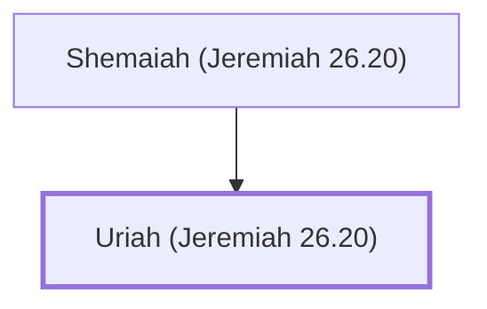

# Uriah (Jeremiah 26.20)

Prophet from Kiriath-jearim who prophesied against Jerusalem

**Original-language names:** אוּרִיָּ֫הוּ (H0223b)

## When

- **Placed around:** [[connections/timeline/7th century BC|610 BC]] *(Ussher: the median date of the passages naming them)*

## Family

- **Father:** [[connections/people/Shemaiah (Jeremiah 26.20)|Shemaiah (Jeremiah 26.20)]]

**Family group:** [[connections/genealogy/Family of Shemaiah (Jeremiah 26.20)|Family of Shemaiah (Jeremiah 26.20)]], generation 2

## Appears in

[[connections/chapters/24-jeremiah/Jeremiah 26|Jeremiah 26 (3)]]

## Appears in the same verse as

[[connections/people/Jehoiakim|Jehoiakim (2)]] · [[connections/places/Egypt|Egypt (2)]] · [[connections/people/Jeremiah (2 Chronicles 35.25)|Jeremiah (2 Chronicles 35.25)]] · [[connections/people/Shemaiah (Jeremiah 26.20)|Shemaiah (Jeremiah 26.20)]] · [[connections/places/Kiriath-jearim|Kiriath-jearim]]
