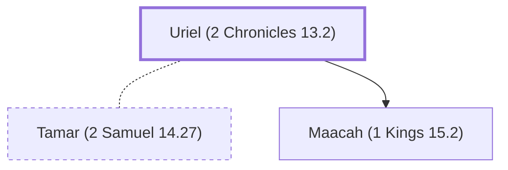

# Uriel (2 Chronicles 13.2)

Father of mother of Abijah, king of Judah

**Original-language names:** אוּרִיאֵל (H0222)

## When

- **Placed around:** [[connections/timeline/10th century BC|958 BC]] *(Ussher: the median date of the passages naming them)*

## Family

- **Spouses:** [[connections/people/Tamar (2 Samuel 14.27)|Tamar (2 Samuel 14.27)]]
- **Children:** [[connections/people/Maacah (1 Kings 15.2)|Maacah (1 Kings 15.2)]]

**Family group:** [[connections/genealogy/Family of Adam|Family of Adam]], generation 38

## Appears in

[[connections/chapters/14-2-chronicles/2 Chronicles 13|2 Chronicles 13]]

## Appears in the same verse as

[[connections/people/Abijah (1 Kings 14.31)|Abijah (1 Kings 14.31)]] · [[connections/people/Jeroboam (1 Kings 11.26)|Jeroboam (1 Kings 11.26)]] · [[connections/people/Maacah (1 Kings 15.2)|Maacah (1 Kings 15.2)]] · [[connections/places/Gibeah (Joshua 15.57)|Gibeah (Joshua 15.57)]] · [[connections/places/Jerusalem|Jerusalem]]
