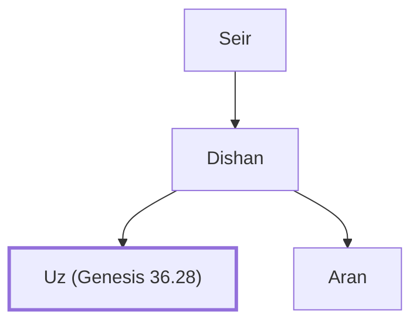

# Uz (Genesis 36.28)

Son of Dishan, a Horite chief

**Original-language names:** עוּץ (H5780)

## When

- **Placed around:** [[connections/timeline/18th century BC|1756 BC]] *(Ussher: the median date of the passages naming them)*

## Family

- **Father:** [[connections/people/Dishan|Dishan]]
- **Brothers and sisters:** [[connections/people/Aran|Aran]]
- **Tribe or nation:** Edom

**Line of descent** (3 generations, father to son): [[connections/people/Seir|Seir]] → [[connections/people/Dishan|Dishan]] → **Uz (Genesis 36.28)**

**Family group:** [[connections/genealogy/Family of Adam|Family of Adam]], generation 3

## Appears in

[[connections/chapters/01-genesis/Genesis 36|Genesis 36]] · [[connections/chapters/13-1-chronicles/1 Chronicles 1|1 Chronicles 1]]

## Appears in the same verse as

[[connections/people/Aran|Aran (2)]] · [[connections/people/Dishan|Dishan (2)]] · [[connections/people/Akan|Akan]] · [[connections/people/Bilhan (Genesis 36.27)|Bilhan (Genesis 36.27)]] · [[connections/people/Ezer (Genesis 36.21)|Ezer (Genesis 36.21)]] · [[connections/people/Zaavan|Zaavan]]
