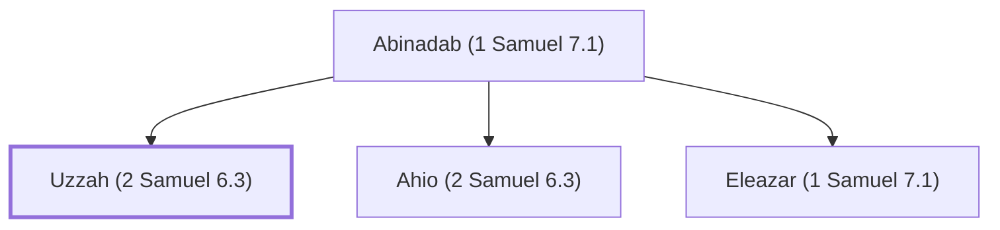

# Uzzah (2 Samuel 6.3)

Died while moving the ark; place named after him

**Also called:** Perez-uzzah

**Original-language names:** עֻזָּא (H5798a) · פֶּרֶץ עֻזָּא (H6560)

## When

- **Placed around:** [[connections/timeline/11th century BC|1042 BC]] *(Ussher: the median date of the passages naming them)*

## Family

- **Father:** [[connections/people/Abinadab (1 Samuel 7.1)|Abinadab (1 Samuel 7.1)]]
- **Brothers and sisters:** [[connections/people/Ahio (2 Samuel 6.3)|Ahio (2 Samuel 6.3)]], [[connections/people/Eleazar (1 Samuel 7.1)|Eleazar (1 Samuel 7.1)]]

**Family group:** [[connections/genealogy/Family of Abinadab (1 Samuel 7.1)|Family of Abinadab (1 Samuel 7.1)]], generation 2

## Appears in

[[connections/chapters/10-2-samuel/2 Samuel 6|2 Samuel 6 (4)]] · [[connections/chapters/13-1-chronicles/1 Chronicles 13|1 Chronicles 13 (4)]]

## Appears in the same verse as

[[connections/people/Abinadab (1 Samuel 7.1)|Abinadab (1 Samuel 7.1) (2)]] · [[connections/people/Ahio (2 Samuel 6.3)|Ahio (2 Samuel 6.3) (2)]] · [[connections/people/David|David (2)]] · [[connections/people/Nacon|Nacon (2)]] · [[connections/places/Perez-uzza|Perez-uzza]]
